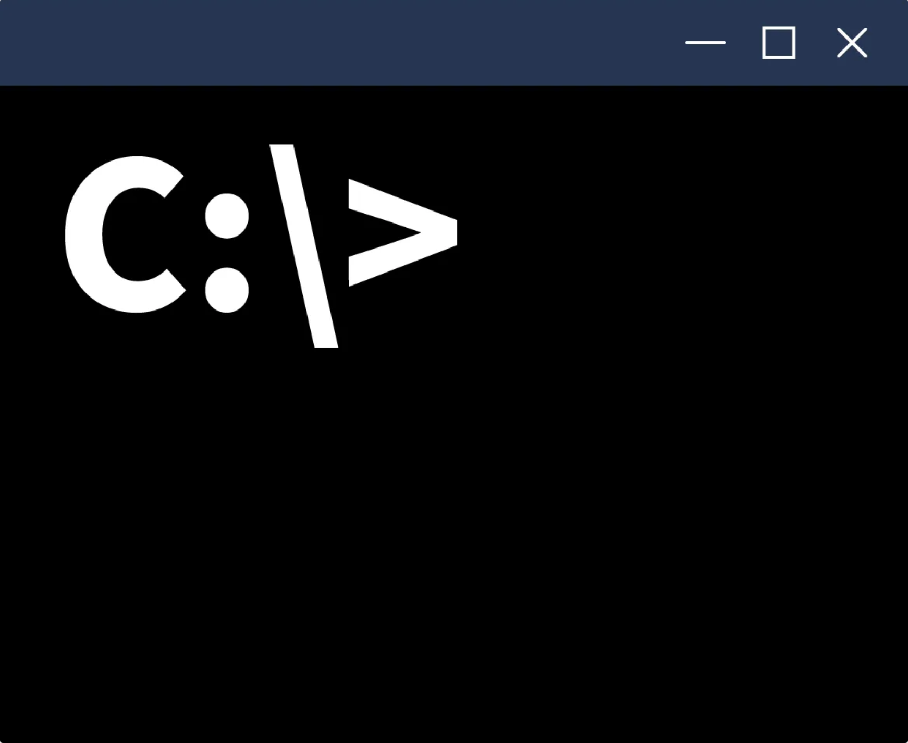
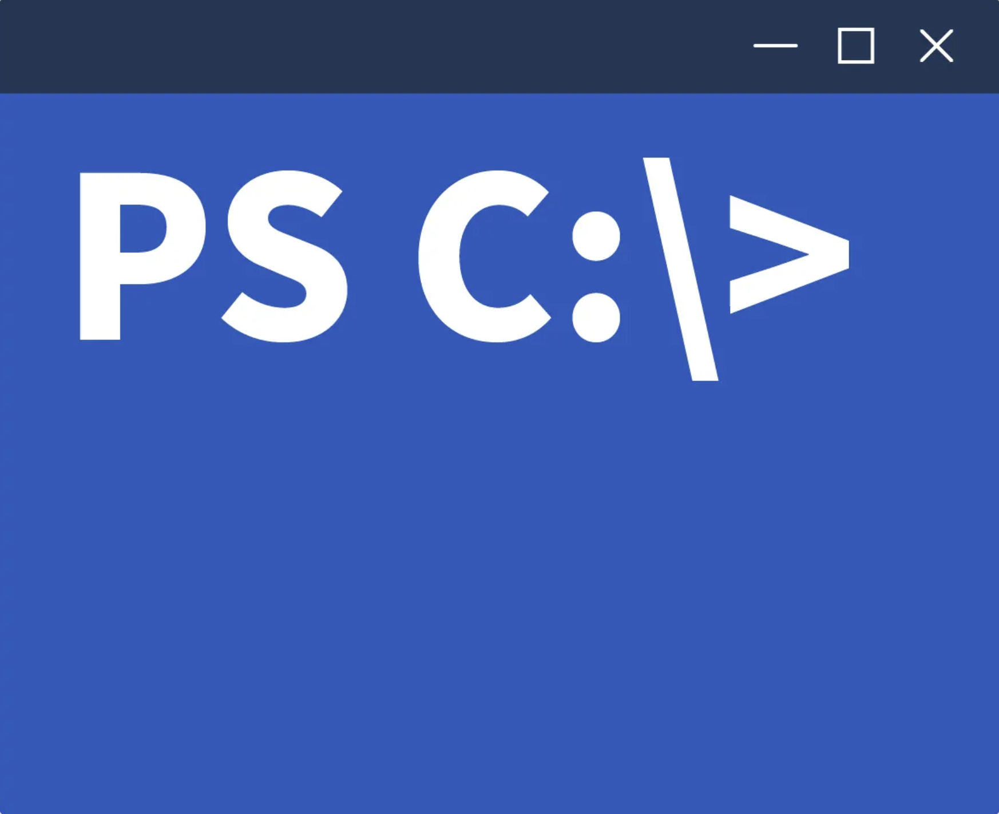
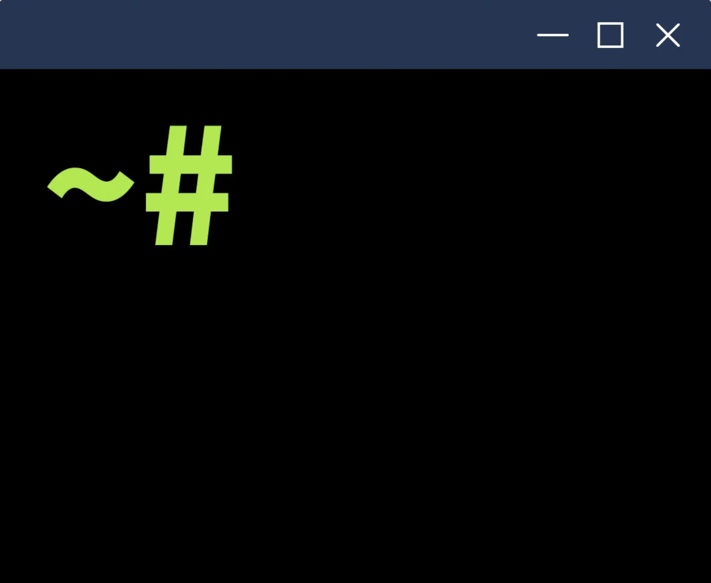

# Windows Command Line

Solo podemos ejecutar aquellos que se encuentren dentro de las rutas definidas en el `Path` de Windows. Puedes usar el comando `set` para consultar tu `Path` desde la línea de comandos. La salida de la terminal siguiente muestra las rutas en las que MS Windows buscará y ejecutará los comandos, indicadas en la línea que empieza por `Path=`.

**Terminal**

```bash
C:\>set
ALLUSERSPROFILE=C:\ProgramData
[...]
LOGNAME=strategos
NUMBER_OF_PROCESSORS=2
OS=Windows_NT
Path=C:\Windows\system32;C:\Windows;C:\Windows\System32\Wbem;C:\Windows\System32\WindowsPowerShell\v1.0\;C:\Windows\System32\OpenSSH\;C:\Windows\system32\config\systemprofile\AppData\Local\Microsoft\WindowsApps;C:\Users\strategos\AppData\Local\Microsoft\WindowsApps;
[...]
```

## Versión del sistema operativo: `ver`

Usemos el comando `ver` para conocer la versión del sistema operativo (SO). La siguiente terminal muestra un ejemplo de salida.

**Terminal**

```bash
C:\>ver
Microsoft Windows [Version 10.0.17763.1821]
```

## Información del sistema: `systeminfo`

Podemos ejecutar el comando `systeminfo` para listar datos del sistema como la información del SO, los detalles del equipo, el procesador y la memoria. 

**Terminal**

```bash
C:\>systeminfo

Host Name:                 WIN-SRV-2019
OS Name:                   Microsoft Windows Server 2019 Datacenter
OS Version:                10.0.17763 N/A Build 17763
OS Manufacturer:           Microsoft Corporation
OS Configuration:          Standalone Server
OS Build Type:             Multiprocessor Free
[...]
```

## Un par de trucos

Antes de continuar, conviene mencionar un par de trucos.

**1. Paginar la salida con `more`.** Si la salida es demasiado larga, puedes canalizarla (*pipe*) a través de `more` para verla página a página pulsando la barra espaciadora. Para comprobarlo, prueba a ejecutar `driverquery` y compáralo con `driverquery | more`. En el segundo caso, la salida se muestra página por página y puedes salir con `CTRL + C`.

```bash
C:\>driverquery | more
```

**2. Comandos de ayuda y limpieza:**

| Comando | Descripción                                             |
| ------- | ------------------------------------------------------- |
| `help`  | Muestra información de ayuda sobre un comando concreto. |
| `cls`   | Limpia la pantalla del Símbolo del sistema.             |

## Configuración de red

Puedes consultar tu información de red con `ipconfig`. La salida de la terminal siguiente muestra nuestra dirección IP, la máscara de subred y la puerta de enlace predeterminada.

**Terminal**

```bash
C:\>ipconfig

Windows IP Configuration

Ethernet adapter Ethernet:

   Connection-specific DNS Suffix  . : eu-west-1.compute.internal
   Link-local IPv6 Address . . . . . : fe80::90df:4861:ba40:f2a8%4
   IPv4 Address. . . . . . . . . . . : 10.10.230.237
   Subnet Mask . . . . . . . . . . . : 255.255.0.0
   Default Gateway . . . . . . . . . : 10.10.0.1
```

También puedes usar `ipconfig /all` para obtener más información sobre tu configuración de red. Como se muestra en la siguiente terminal, podemos ver nuestros servidores DNS y confirmar que DHCP está habilitado.

**Terminal**

```bash
C:\>ipconfig /all

Ethernet adapter Ethernet 3:

   Connection-specific DNS Suffix  . : eu-west-1.compute.internal
   Description . . . . . . . . . . . : Amazon Elastic Network Adapter
   Physical Address. . . . . . . . . : 02-B7-DF-1D-0D-99
   DHCP Enabled. . . . . . . . . . . : Yes
   Autoconfiguration Enabled . . . . : Yes
   Link-local IPv6 Address . . . . . : fe80::90df:4861:ba40:f2a8%4(Preferred) 
   IPv4 Address. . . . . . . . . . . : 10.10.230.237(Preferred) 
   Subnet Mask . . . . . . . . . . . : 255.255.0.0
   Lease Obtained. . . . . . . . . . : Wednesday, May 1, 2024 2:38:05 PM
   Lease Expires . . . . . . . . . . : Wednesday, May 1, 2024 4:08:07 PM
   Default Gateway . . . . . . . . . : 10.10.0.1
   DHCP Server . . . . . . . . . . . : 10.10.0.1
   DHCPv6 IAID . . . . . . . . . . . : 134353458
   DHCPv6 Client DUID. . . . . . . . : 00-01-00-01-27-E3-D1-2B-0E-F8-30-D0-72-3F
   DNS Servers . . . . . . . . . . . : 10.0.0.2
   NetBIOS over Tcpip. . . . . . . . : Enabled
```

## `ping`

Una tarea habitual de diagnóstico es comprobar si el equipo puede acceder a un servidor concreto de Internet. La sintaxis del comando es `ping nombre_del_destino`. Inspirado en el ping-pong, enviamos un paquete ICMP específico y esperamos una respuesta. Si la recibimos, sabemos que podemos alcanzar el destino y que este puede alcanzarnos a nosotros.

Comprobemos si llegamos a `example.com`. En la salida de la terminal siguiente vemos que hemos recibido cuatro respuestas con éxito. Además, obtenemos algunas estadísticas; por ejemplo, el tiempo medio de ida y vuelta (*round trip time*) es de 78 milisegundos.

**Terminal**

```bash
C:\>ping example.com

Pinging example.com [93.184.215.14] with 32 bytes of data:
Reply from 93.184.215.14: bytes=32 time=78ms TTL=52
Reply from 93.184.215.14: bytes=32 time=78ms TTL=52
Reply from 93.184.215.14: bytes=32 time=78ms TTL=52
Reply from 93.184.215.14: bytes=32 time=78ms TTL=52

Ping statistics for 93.184.215.14:
    Packets: Sent = 4, Received = 4, Lost = 0 (0% loss),
Approximate round trip times in milli-seconds:
    Minimum = 78ms, Maximum = 78ms, Average = 78ms
```

## `tracert`

Otra herramienta muy valiosa para el diagnóstico es `tracert` (de *trace route*, rastreo de ruta). El comando `tracert nombre_del_destino` traza la ruta de red que se recorre para llegar al destino. Sin entrar en demasiados detalles, funciona esperando que los routers del camino nos avisen cuando descartan un paquete porque su tiempo de vida (*TTL*, *time-to-live*) ha llegado a cero. La salida de la terminal siguiente muestra que hemos pasado por 15 routers antes de llegar a nuestro destino.

**Terminal**

```bash
C:\>tracert example.com

Tracing route to example.com [93.184.215.14]
over a maximum of 30 hops:

  1    59 ms    32 ms    42 ms  ec2-3-248-240-3.eu-west-1.compute.amazonaws.com [3.248.240.3]
  2     *        *        *     Request timed out.
  3     *        *        *     Request timed out.
  4     *        *        *     Request timed out.
  5     *        *        *     Request timed out.
  6     *        *        *     Request timed out.
  7     *        *        *     Request timed out.
  8     *        *        *     Request timed out.
  9    <1 ms    13 ms    <1 ms  100.100.2.56
 10    15 ms    11 ms    11 ms  ae-42.a03.londen12.uk.bb.gin.ntt.net [131.103.117.104]
 11    17 ms    11 ms    12 ms  ae-14.r20.londen12.uk.bb.gin.ntt.net [129.250.3.248]
 12    81 ms    80 ms    80 ms  ae-7.r20.nwrknj03.us.bb.gin.ntt.net [129.250.6.147]
 13    83 ms    83 ms    86 ms  ae-0.a02.nycmny17.us.bb.gin.ntt.net [129.250.3.9]
 14    79 ms    79 ms    96 ms  ce-0-3-0.a02.nycmny17.us.ce.gin.ntt.net [128.241.1.14]
 15    81 ms    86 ms    79 ms  ae-67.core1.nyd.edgecastcdn.net [152.195.68.135]
 16    78 ms    78 ms    78 ms  93.184.215.14

Trace complete.
```

## `nslookup`

Un comando de red que conviene conocer es `nslookup`. Consulta un host o dominio y devuelve su dirección IP. La sintaxis `nslookup example.com` consulta `example.com` usando el servidor de nombres predeterminado, mientras que `nslookup example.com 1.1.1.1` usa el servidor de nombres `one.one.one.one`. La terminal siguiente muestra la salida de ambos comandos. Los resultados son idénticos, pero se aprecia que las respuestas se obtuvieron de servidores de nombres distintos.

**Terminal**

```bash
C:\>nslookup example.com
Server:  ip-10-0-0-2.eu-west-1.compute.internal
Address:  10.0.0.2

Non-authoritative answer:
Name:    example.com
Addresses:  2606:2800:21f:cb07:6820:80da:af6b:8b2c
          93.184.215.14

C:>nslookup example.com 1.1.1.1
Server:  one.one.one.one
Address:  1.1.1.1

Non-authoritative answer:
Name:    example.com
Addresses:  2606:2800:21f:cb07:6820:80da:af6b:8b2c
          93.184.215.14
```

## `netstat`

Este comando muestra las conexiones de red actuales y los puertos en escucha. Un `netstat` básico, sin argumentos, muestra las conexiones establecidas, como se ve a continuación. En este caso solo tenemos una conexión SSH; sabemos que es SSH porque está vinculada al puerto 22.

**Terminal**

```bash
C:\>netstat

Active Connections

  Proto  Local Address          Foreign Address        State
  TCP    10.10.230.237:22       ip-10-11-81-126:53486  ESTABLISHED
```

Si tienes curiosidad por las demás opciones, puedes ejecutar `netstat -h`, donde `-h` muestra la página de ayuda. Nosotros hemos elegido las siguientes opciones:

| Opción | Descripción                                                                                   |
| ------ | --------------------------------------------------------------------------------------------- |
| `-a`   | Muestra todas las conexiones establecidas y los puertos en escucha.                           |
| `-b`   | Muestra el programa asociado a cada puerto en escucha y a cada conexión establecida.          |
| `-o`   | Muestra el ID de proceso (PID) asociado a la conexión.                                        |
| `-n`   | Usa la forma numérica para las direcciones y los números de puerto.                           |

Combinamos estas cuatro opciones y ejecutamos `netstat -abon`. El resultado es bastante largo, pero en la terminal siguiente mostramos las primeras líneas. Ahora queda claro que el ejecutable `sshd.exe` es el responsable de escuchar las conexiones entrantes en el puerto 22, como se ve en la primera línea. También podemos ver el ID de proceso (PID) asociado a cada conexión.

**Terminal**

```bash
C:\>netstat -abon

Active Connections

  Proto  Local Address          Foreign Address        State           PID 
  TCP    0.0.0.0:22             0.0.0.0:0              LISTENING       2116
 [sshd.exe]
  TCP    0.0.0.0:135            0.0.0.0:0              LISTENING       820
  RpcSs 
 [svchost.exe]
[...]
  TCP    0.0.0.0:49669          0.0.0.0:0              LISTENING       2036
 [spoolsv.exe]
  TCP    0.0.0.0:49670          0.0.0.0:0              LISTENING       584 
 Can not obtain ownership information
  TCP    0.0.0.0:49686          0.0.0.0:0              LISTENING       592
 [lsass.exe]
  TCP    10.10.230.237:22       10.11.81.126:53486     ESTABLISHED     2116 
 [sshd.exe]
 [...]
```

## Trabajar con directorios

Puedes usar `cd` sin parámetros para mostrar la unidad y el directorio actuales. Es el equivalente a preguntarle al sistema: ¿dónde estoy?.

Puedes ver los directorios hijos con `dir`.

**Terminal**

```bash
C:\Users\strategos>cd
C:\Users\strategos

C:\Users\strategos>dir 
 Volume in drive C has no label. 
 Volume Serial Number is A8A4-C362

 Directory of C:\Users\strategos

05/01/2024  02:40 PM    <DIR>          .
05/01/2024  02:40 PM    <DIR>          ..
11/14/2018  06:56 AM    <DIR>          Desktop
05/01/2024  02:40 PM    <DIR>          Documents
09/15/2018  07:19 AM    <DIR>          Downloads
09/15/2018  07:19 AM    <DIR>          Favorites
09/15/2018  07:19 AM    <DIR>          Links
09/15/2018  07:19 AM    <DIR>          Music
09/15/2018  07:19 AM    <DIR>          Pictures
09/15/2018  07:19 AM    <DIR>          Saved Games
09/15/2018  07:19 AM    <DIR>          Videos
               0 File(s)              0 bytes
              11 Dir(s)  14,984,953,856 bytes free
```

Ten en cuenta que puedes usar las siguientes opciones con `dir`:

| Comando   | Descripción                                                                    |
| --------- | ------------------------------------------------------------------------------ |
| `dir /a`  | Muestra también los archivos ocultos y de sistema.                             |
| `dir /s`  | Muestra los archivos del directorio actual y de todos sus subdirectorios.      |

## Representar la estructura con `tree`

Puedes escribir `tree` para representar visualmente los directorios hijos y subdirectorios.

**Terminal**

```bash
C:\Users\strategos>tree
Folder PATH listing
Volume serial number is A8A4-C362
C:.
├───Desktop
├───Documents
├───Downloads
├───Favorites
├───Links
├───Music
├───Pictures
├───Saved Games
└───Videos
```

## Cambiar de directorio con `cd`

Puedes cambiar a cualquier directorio con el comando `cd directorio_destino`; es el equivalente a hacer doble clic sobre ese directorio en el escritorio. Además, puedes usar `cd ..` para subir un nivel. En la salida de la terminal siguiente se muestra un ejemplo.

**Terminal**

```bash
C:\>cd
C:\

C:\>cd Users

C:\Users>cd 
C:\Users 

C:\Users>cd .. 

C:\>cd 
C:\ 
```

## Crear y eliminar directorios

Para crear un directorio, usa `mkdir nombre_directorio` (*make directory*). Para eliminarlo, usa `rmdir nombre_directorio` (*remove directory*). La salida de la terminal siguiente muestra cómo crear y eliminar un directorio.

**Terminal**

```bash
C:\example>mkdir backup_files

strategos@WIN-SRV-2019 C:\example>dir
 Directory of C:\example

05/02/2024  07:36 AM    <DIR>          .
05/02/2024  07:36 AM    <DIR>          ..
05/02/2024  07:36 AM    <DIR>          backup_files
               0 File(s)              0 bytes
               3 Dir(s)  14,984,724,480 bytes free

C:\example>rmdir backup_files

C:\example>dir 
 Directory of C:\example

05/02/2024  07:36 AM    <DIR>          .
05/02/2024  07:36 AM    <DIR>          ..
               0 File(s)              0 bytes
               2 Dir(s)  14,984,724,480 bytes free
```

## Ver el contenido: `type` y `more`

Estás trabajando en la línea de comandos y sientes curiosidad por el contenido de un archivo de texto. Puedes verlo fácilmente con el comando `type`, que vuelca el contenido del archivo en pantalla; es muy cómodo para archivos que caben en la ventana de la terminal.

Para archivos de texto más largos, conviene usar `more`. Este comando muestra el contenido suficiente para llenar la ventana de la terminal. Es decir, en archivos largos, `more` muestra una página y espera a que pulses la **barra espaciadora** para avanzar una página, o **Enter** para avanzar una línea.

## Copiar archivos: `copy`

El comando `copy` permite copiar archivos de una ubicación a otra. La siguiente salida de terminal muestra un ejemplo.

**Terminal**

```bash
C:\example>dir
 Directory of C:\example

05/02/2024  08:12 AM    <DIR>          .
05/02/2024  08:12 AM    <DIR>          ..
05/02/2024  07:57 AM                17 test.txt
               1 File(s)             17 bytes
               2 Dir(s)  14,983,409,664 bytes free

C:\example>copy test.txt test2.txt
        1 file(s) copied.

C:\example>dir
 Directory of C:\example

05/02/2024  08:12 AM    <DIR>          .
05/02/2024  08:12 AM    <DIR>          ..
05/02/2024  07:57 AM                17 test.txt
05/02/2024  07:57 AM                17 test2.txt
               2 File(s)             34 bytes
               2 Dir(s)  14,983,409,664 bytes free
```

## Mover archivos: `move`

De forma similar, puedes mover archivos con el comando `move`. En la salida de la terminal siguiente se muestra un ejemplo.

**Terminal**

```bash
C:\example>dir
 Directory of C:\example

05/02/2024  08:12 AM    <DIR>          .
05/02/2024  08:12 AM    <DIR>          ..
05/02/2024  07:57 AM                17 test.txt
05/02/2024  07:57 AM                17 test2.txt
               2 File(s)             34 bytes
               2 Dir(s)  14,983,409,664 bytes free

C:\example>move test2.txt .. 
        1 file(s) moved. 

C:\example>dir 
 Directory of C:\example

05/02/2024  08:13 AM    <DIR>          .
05/02/2024  08:13 AM    <DIR>          ..
05/02/2024  07:57 AM                17 test.txt
               1 File(s)             17 bytes
               2 Dir(s)  14,983,409,664 bytes free
```

## Eliminar archivos: `del` o `erase`

Por último, podemos eliminar un archivo con `del` o `erase`.

**Terminal**

```bash
C:\example>dir
 Directory of C:\example

05/02/2024  08:16 AM    <DIR>          .
05/02/2024  08:16 AM    <DIR>          ..
05/02/2024  07:57 AM                17 test.txt
05/02/2024  07:57 AM                17 test2.txt
               2 File(s)             34 bytes
               2 Dir(s)  14,983,409,664 bytes free

C:\example>erase test2.txt

C:\example>dir 
 Directory of C:\example

05/02/2024  08:16 AM    <DIR>          .
05/02/2024  08:16 AM    <DIR>          ..
05/02/2024  07:57 AM                17 test.txt
               1 File(s)             17 bytes
               2 Dir(s)  14,983,409,664 bytes free
```

## El carácter comodín `*`

Podemos usar el carácter comodín `*` para referirnos a varios archivos a la vez. Por ejemplo, el siguiente comando copiará todos los archivos con extensión `md` al directorio `C:\Markdown`:

```bash
C:\>copy *.md C:\Markdown
```

## Listar procesos: `tasklist`

Podemos listar los procesos en ejecución con `tasklist`.

**Terminal**

```bash
C:\>tasklist

Image Name                     PID Session Name        Session#    Mem Usage 
========================= ======== ================ =========== ============
System Idle Process              0 Services                   0          8 K
System                           4 Services                   0         88 K
Registry                        84 Services                   0     50,700 K
smss.exe                       276 Services                   0      1,132 K
csrss.exe                      372 Services                   0      5,264 K
wininit.exe                    448 Services                   0      6,892 K
csrss.exe                      456 Console                    1      5,028 K
winlogon.exe                   516 Console                    1     11,144 K
services.exe                   584 Services                   0      7,492 K
lsass.exe                      592 Services                   0     16,108 K
svchost.exe                    704 Services                   0     23,432 K
fontdrvhost.exe                736 Console                    1      4,256 K
[...]
```

## Filtrar la salida

Como la salida suele ser muy larga, resulta útil filtrarla. Puedes consultar todos los filtros disponibles en la página de ayuda con `tasklist /?`.

Supongamos que queremos buscar las tareas relacionadas con `sshd.exe`. Podemos hacerlo con el siguiente comando:

```bash
C:\>tasklist /FI "imagename eq sshd.exe"
```

Ten en cuenta que `/FI` sirve para establecer un filtro (*filter*), en este caso, que el nombre de la imagen sea igual a `sshd.exe`.

**Terminal**

```bash
C:\>tasklist /FI "imagename eq sshd.exe"

Image Name                     PID Session Name        Session#    Mem Usage
========================= ======== ================ =========== ============
sshd.exe                      2116 Services                   0      6,992 K
sshd.exe                      2712 Services                   0      7,668 K
sshd.exe                      4752 Services                   0      7,372 K
```

## Terminar procesos: `taskkill`

Una vez conocido el ID de proceso (PID), podemos terminar cualquier tarea con `taskkill /PID pid_destino`. Por ejemplo, si queremos terminar el proceso con PID 4567, ejecutaríamos:

```bash
C:\>taskkill /PID 4567
```
## Otro comandos:

| Comando         | Descripción                                                                                  |
| --------------- | -------------------------------------------------------------------------------------------- |
| `chkdsk`        | Comprueba el sistema de archivos y los volúmenes de disco en busca de errores y sectores defectuosos. |
| `driverquery`   | Muestra una lista de los controladores de dispositivo instalados.                            |
| `sfc /scannow`  | Analiza los archivos del sistema en busca de daños y los repara si es posible.               |
| `shutdown /r`   | Apaga el equipo y luego lo reinicia.  |
| `shutdown /a`  | Cancela un apagado o reinicio del sistema que esté pendiente.
|

Además, es igual de importante saber que `/?` se puede usar con la mayoría de los comandos para mostrar su página de ayuda.

## Dos usos de `more`

En esta sala usamos el comando `more` de dos maneras:

- **Mostrar archivos de texto:**

```bash
  C:\>more file.txt
```

- **Canalizar (*pipe*) una salida larga para verla página a página:**

```bash
  C:\>algun_comando | more
```

Con estos conocimientos, ya sabemos cómo mostrar la página de ayuda de un comando nuevo y cómo visualizar una salida larga una página cada vez.



# Windows PowerShell

PowerShell se puede iniciar de varias maneras, según tus necesidades y tu entorno. Si trabajas en un sistema Windows desde la interfaz gráfica (GUI), estas son algunas de las formas posibles:

| Método | Descripción |
| ------ | ----------- |
| **Menú Inicio** | Escribe `powershell` en la barra de búsqueda del menú Inicio y haz clic en *Windows PowerShell* o *PowerShell* en los resultados. |
| **Ejecutar** | Pulsa `Win + R` para abrir el cuadro de diálogo Ejecutar, escribe `powershell` y pulsa Enter. |
| **Explorador de archivos** | Navega a cualquier carpeta, escribe `powershell` en la barra de direcciones y pulsa Enter. Así se abre PowerShell en ese directorio concreto. |
| **Administrador de tareas** | Abre el Administrador de tareas, ve a *Archivo > Ejecutar nueva tarea*, escribe `powershell` y pulsa Enter. |

Alternativamente, PowerShell se puede iniciar desde el Símbolo del sistema (`cmd.exe`) escribiendo `powershell` y pulsando Enter.

En nuestro caso, como solo tenemos acceso al Símbolo del sistema de la máquina virtual objetivo, este es el método que usaremos.

**Terminal**

```
captain@THEBLACKPEARL C:\Users\captain>powershell
Windows PowerShell
Copyright (C) Microsoft Corporation. All rights reserved.

Install the latest PowerShell for new features and improvements! https://aka.ms/PSWindows

PS C:\Users\captain> 
```

Una vez iniciado PowerShell, se nos presenta un prompt `PS` (de *PowerShell*) en el directorio de trabajo actual.

## Sintaxis básica: Verbo-Sustantivo

Como ya se mencionó, los comandos de PowerShell se conocen como **cmdlets** (se pronuncia *command-lets*). Son mucho más potentes que los comandos tradicionales de Windows y permiten una manipulación de datos más avanzada.

Los cmdlets siguen una convención de nombres coherente: **Verbo-Sustantivo** (*Verb-Noun*). Esta estructura facilita entender qué hace cada cmdlet. El verbo describe la acción y el sustantivo especifica el objeto sobre el que se realiza. Por ejemplo:

| Cmdlet | Descripción |
| ------ | ----------- |
| `Get-Content` | Obtiene el contenido de un archivo y lo muestra en la consola. |
| `Set-Location` | Cambia el directorio de trabajo actual. |

## `Get-Command`

Para listar todos los cmdlets, funciones, alias y scripts que se pueden ejecutar en la sesión actual de PowerShell, podemos usar `Get-Command`. Es una herramienta esencial para descubrir qué comandos podemos utilizar.

**Terminal**

```
PS C:\Users\captain> Get-Command

CommandType     Name                                               Version    Source 
-----------     ----                                               -------    ------ 

Alias           Add-AppPackage                                     2.0.1.0    Appx                                                                                                                                       
Alias           Add-AppPackageVolume                               2.0.1.0    Appx                                                                                                                                       
Alias           Add-AppProvisionedPackage                          3.0        Dism                                                                                                                                       
[...]
Function        A:
Function        Add-BCDataCacheExtension                           1.0.0.0    BranchCache                                                                                                                                
Function        Add-DnsClientDohServerAddress                      1.0.0.0    DnsClient
[...]
Cmdlet          Add-AppxPackage                                    2.0.1.0    Appx
Cmdlet          Add-AppxProvisionedPackage                         3.0        Dism                                                                                                                                       
Cmdlet          Add-AppxVolume                                     2.0.1.0    Appx
[...]
```

Por cada objeto `CommandInfo` que recupera el cmdlet, se muestra en la consola cierta información esencial (propiedades). Es posible filtrar la lista de comandos según los valores de las propiedades mostradas. Por ejemplo, si queremos mostrar solo los comandos de tipo función, podemos usar `-CommandType "Function"`, como se muestra a continuación:

**Terminal**

```
PS C:\Users\captain> Get-Command -CommandType "Function"

CommandType     Name                                               Version    Source                                                                                                                                     
-----------     ----                                               -------    ------
Function        A:
Function        Add-BCDataCacheExtension                           1.0.0.0    BranchCache
Function        Add-DnsClientDohServerAddress                      1.0.0.0    DnsClient
Function        Add-DnsClientNrptRule                              1.0.0.0    DnsClient
[...]
```

**Ejemplo:** Para obtener una lista de los comandos que empiezan por el verbo Remove: Get-Command -Name Remove

## `Get-Help`

Otro cmdlet esencial para tener a mano es `Get-Help`: proporciona información detallada sobre los cmdlets, incluyendo su uso, parámetros y ejemplos. Es el recurso de referencia para aprender a usar los comandos de PowerShell.

**Terminal**

```
PS C:\Users\captain> Get-Help Get-Date

NAME
    Get-Date

SYNOPSIS
    Gets the current date and time.

SYNTAX
    Get-Date [[-Date] <System.DateTime>] [-Day <System.Int32>] [-DisplayHint {Date | Time | DateTime}] [-Format <System.String>] [-Hour <System.Int32>] [-Millisecond <System.Int32>] [-Minute <System.Int32>] [-Month <System.Int32>] [-Second <System.Int32>] [-Year <System.Int32>] [<CommonParameters>]

    Get-Date [[-Date] <System.DateTime>] [-Day <System.Int32>] [-DisplayHint {Date | Time | DateTime}] [-Hour <System.Int32>] [-Millisecond <System.Int32>] [-Minute <System.Int32>] [-Month <System.Int32>] [-Second <System.Int32>] [-UFormat <System.String>] [-Year <System.Int32>] [<CommonParameters>]

DESCRIPTION
        The `Get-Date` cmdlet gets a DateTime object that represents the current date or a date that you specify. `Get-Date` can format the date and time in several .NET and UNIX formats. You can use `Get-Date` to generate a date or time character string, and then send the string to other cmdlets or programs.
        
        `Get-Date` uses the current culture settings of the operating system to determine how the output is formatted. To view your computer's settings, use `(Get-Culture).DateTimeFormat`.

RELATED LINKS
    Online Version: https://learn.microsoft.com/powershell/module/microsoft.powershell.utility/get-date?view=powershell-5.1&WT.mc_id=ps-gethelp
    ForEach-Object
    Get-Culture
    Get-Member
    New-Item
    New-TimeSpan
    Set-Date
    Set-Culture xref:International.Set-Culture

REMARKS
    To see the examples, type: "get-help Get-Date -examples".
    For more information, type: "get-help Get-Date -detailed".
    For technical information, type: "get-help Get-Date -full".
    For online help, type: "get-help Get-Date -online".
```

Como muestran los resultados anteriores, `Get-Help` nos indica que podemos obtener otra información útil sobre un cmdlet añadiendo algunas opciones a la sintaxis básica. Por ejemplo, si añadimos `-examples` al comando mostrado arriba, se nos mostrará una lista de las formas más comunes de usar ese cmdlet:

```
PS C:\Users\captain> Get-Help Get-Date -examples
```

## `Get-Alias`

Para facilitar la transición de los profesionales de TI, PowerShell incluye **alias** (atajos o nombres alternativos de los cmdlets) para muchos comandos tradicionales de Windows. Son indispensables para quienes ya conocen otras herramientas de línea de comandos, y `Get-Alias` lista todos los alias disponibles. Por ejemplo, `dir` es un alias de `Get-ChildItem` y `cd` es un alias de `Set-Location`.

**Terminal**

```
PS C:\Users\captain> Get-Alias

CommandType     Name                                               Version    Source
-----------     ----                                               -------    ------
Alias           % -> ForEach-Object
Alias           ? -> Where-Object
Alias           ac -> Add-Content
Alias           asnp -> Add-PSSnapin
Alias           cat -> Get-Content
Alias           cd -> Set-Location
Alias           CFS -> ConvertFrom-String                          3.1.0.0    Microsoft.PowerShell.Utility
Alias           chdir -> Set-Location 
Alias           clc -> Clear-Content
Alias           clear -> Clear-Host
[...]
```

## Dónde encontrar y descargar cmdlets

Otra característica potente de PowerShell es la posibilidad de ampliar su funcionalidad descargando cmdlets adicionales desde repositorios en línea.

> **Nota:** los cmdlets de esta sección requieren una conexión a internet activa para consultar los repositorios en línea. La máquina adjunta no tiene acceso a internet, por lo que estos comandos no funcionarán en este entorno.

## `Find-Module`

Para buscar **módulos** (colecciones de cmdlets) en repositorios en línea como la *PowerShell Gallery*, podemos usar `Find-Module`. A veces, si no conocemos el nombre exacto del módulo, resulta útil buscar módulos con un nombre parecido. Lo logramos filtrando la propiedad `Name` y añadiendo un comodín (`*`) al nombre parcial del módulo, con la siguiente sintaxis estándar de PowerShell:

```
Cmdlet -Propiedad "patrón*"
```

**Terminal**

```
PS C:\Users\captain> Find-Module -Name "PowerShell*"   

Version    Name                                Repository           Description 
-------    ----                                ----------           ----------- 
0.4.7      powershell-yaml                     PSGallery            Powershell module for serializing and deserializing YAML

2.2.5      PowerShellGet                       PSGallery            PowerShell module with commands for discovering, installing, updating and publishing the PowerShell artifacts like Modules, DSC Resources, Role Capabilities and Scripts.                                                   
1.0.80.0   PowerShell.Module.InvokeWinGet      PSGallery            Module to Invoke WinGet and parse the output in PSOjects

0.17.0     PowerShellForGitHub                 PSGallery            PowerShell wrapper for GitHub API  
```

## `Install-Module`

Una vez identificados, los módulos se pueden descargar e instalar desde el repositorio con `Install-Module`, lo que hace disponibles los nuevos cmdlets que contiene el módulo.

**Terminal**

```
PS C:\Users\captain> Install-Module -Name "PowerShellGet"

Untrusted repository
You are installing the modules from an untrusted repository. If you trust this repository, change its InstallationPolicy value by running the Set-PSRepository cmdlet. Are you sure you want to install the modules from 'PSGallery'?
[Y] Yes  [A] Yes to All  [N] No  [L] No to All  [S] Suspend  [?] Help (default is "N"):
```
El cmdlet tiene como alias a su equivalente tradicional `echo` es Write-Output. Puedes comprobarlo con:

```
Get-Alias -Name echo
```
Debería mostrar echo -> Write-Output.

El comando para obtener ejemplos de uso del cmdlet `New-LocalUser`: 
```
Get-Help New-LocalUser -Examples
```

## Listar contenido: `Get-ChildItem`

De forma similar al comando `dir` del Símbolo del sistema (o a `ls` en sistemas tipo Unix), `Get-ChildItem` lista los archivos y directorios de una ubicación especificada con el parámetro `-Path`. Se puede usar para explorar directorios y ver su contenido. Si no se especifica ninguna ruta, el cmdlet mostrará el contenido del directorio de trabajo actual.

**Terminal**

```
PS C:\Users\captain> Get-ChildItem 

    Directory: C:\Users\captain

Mode                 LastWriteTime         Length Name
----                 -------------         ------ ----
d-r---          5/8/2021   9:15 AM                Desktop
d-r---          9/4/2024  10:58 AM                Documents
d-r---          5/8/2021   9:15 AM                Downloads
d-r---          5/8/2021   9:15 AM                Favorites
d-r---          5/8/2021   9:15 AM                Links
d-r---          5/8/2021   9:15 AM                Music
d-r---          5/8/2021   9:15 AM                Pictures
d-----          5/8/2021   9:15 AM                Saved Games
d-r---          5/8/2021   9:15 AM                Videos
```

**Ejemplo:** El comando para mostrar el contenido del directorio C:\Users?:
```
Get-ChildItem -Path C:\Users
```

## Contar elementos con `Measure-Object`
El comando `Get-Command -Name Remove*` mostrará varios elementos, pero para saber el número exacto puedes canalizarlo (*pipe*) a `Measure-Object`, así:
```
Get-Command -Name Remove* | Measure-Object
```

Esto te dará el recuento de cuántos elementos coinciden con ese patrón. La cifra aparece en la propiedad `Count` de la salida.

> **Nota:** el resultado depende de los módulos cargados en la máquina, por lo que conviene ejecutarlo en la VM de la sala.

## Cambiar de directorio: `Set-Location`

Para navegar a un directorio diferente, podemos usar el cmdlet `Set-Location`. Cambia el directorio actual y nos lleva a la ruta especificada, igual que el comando `cd` del Símbolo del sistema.

**Terminal**

```bash
PS C:\Users\captain> Set-Location -Path ".\Documents"
PS C:\Users\captain\Documents> 
```

## Crear elementos: `New-Item`

Mientras que la CLI tradicional de Windows usa comandos distintos para crear y gestionar diferentes elementos, como directorios y archivos, PowerShell simplifica este proceso con un único conjunto de cmdlets para crear y gestionar tanto archivos como directorios.

Para crear un elemento en PowerShell podemos usar `New-Item`. Necesitaremos especificar la ruta del elemento y su tipo (si es un archivo o un directorio).

**Terminal**

```
PS C:\Users\captain\Documents> New-Item -Path ".\captain-cabin\captain-wardrobe" -ItemType "Directory"

    Directory: C:\Users\captain\Documents\captain-cabin

Mode                 LastWriteTime         Length Name
----                 -------------         ------ ----
d-----          9/4/2024  12:20 PM                captain-wardrobe

PS C:\Users\captain\Documents> New-Item -Path ".\captain-cabin\captain-wardrobe\captain-boots.txt" -ItemType "File"     

    Directory: C:\Users\captain\Documents\captain-cabin\captain-wardrobe

Mode                 LastWriteTime         Length Name
----                 -------------         ------ ----
-a----          9/4/2024  11:46 AM              0 captain-boots.txt  
```

## Eliminar elementos: `Remove-Item`

De forma similar, el cmdlet `Remove-Item` elimina tanto directorios como archivos, mientras que en la CLI de Windows tenemos comandos separados: `rmdir` y `del`.

**Terminal**

```
PS C:\Users\captain\Documents> Remove-Item -Path ".\captain-cabin\captain-wardrobe\captain-boots.txt"
PS C:\Users\captain\Documents> Remove-Item -Path ".\captain-cabin\captain-wardrobe" 
```

## Copiar y mover elementos: `Copy-Item` y `Move-Item`

Podemos copiar o mover tanto archivos como directorios usando, respectivamente, `Copy-Item` (equivalente a `copy`) y `Move-Item` (equivalente a `move`).

**Terminal**

```
PS C:\Users\captain\Documents> Copy-Item -Path .\captain-cabin\captain-hat.txt -Destination .\captain-cabin\captain-hat2.txt
PS C:\Users\captain\Documents> Get-ChildItem -Path ".\captain-cabin\" 

    Directory: C:\Users\captain\Documents\captain-cabin

Mode                 LastWriteTime         Length Name 
----                 -------------         ------ ----
d-----          9/4/2024  12:50 PM                captain-wardrobe
-a----          9/4/2024  12:50 PM              0 captain-boots.txt
-a----          9/4/2024  12:14 PM            264 captain-hat.txt
-a----          9/4/2024  12:14 PM            264 captain-hat2.txt
-a----          9/4/2024  12:37 PM           2116 ship-flag.txt 
```

## Leer el contenido de un archivo: `Get-Content`

Por último, para leer y mostrar el contenido de un archivo podemos usar el cmdlet `Get-Content`, que funciona de forma similar al comando `type` del Símbolo del sistema (o a `cat` en sistemas tipo Unix).

**Terminal**

```
PS C:\Users\captain\Documents\captain-cabin> Get-Content -Path ".\captain-hat.txt"
 _           _   
| |         | |
| |__   __ _| |_
| '_ \ / _ | __|
| | | | (_| | |_
|_| |_|\__,_|\__|

Don't touch my hat!
```

## Canalización, filtrado y ordenación de datos

La **canalización** (*piping*) es una técnica usada en los entornos de línea de comandos que permite que la salida de un comando se utilice como entrada de otro. Esto crea una secuencia de operaciones en la que los datos fluyen de un comando al siguiente. Se representa con el símbolo `|` y se usa ampliamente en la CLI de Windows, como vimos antes en este módulo, así como en los shells basados en Unix.

En PowerShell, la canalización es aún más potente porque transmite **objetos** en lugar de simple texto. Estos objetos no solo contienen los datos, sino también las propiedades y métodos que los describen y permiten interactuar con ellos.

## Ordenar objetos: `Sort-Object`

Por ejemplo, si quieres obtener una lista de los archivos de un directorio y ordenarlos por tamaño, puedes usar el siguiente comando en PowerShell:

**Terminal**

```
PS C:\Users\captain\Documents\captain-cabin> Get-ChildItem | Sort-Object Length

    Directory: C:\Users\captain\Documents\captain-cabin

Mode                 LastWriteTime         Length Name
----                 -------------         ------ ----
-a----          9/4/2024  12:50 PM              0 captain-boots.txt
-a----          9/4/2024  12:14 PM            264 captain-hat2.txt
-a----          9/4/2024  12:14 PM            264 captain-hat.txt
-a----          9/4/2024  12:37 PM           2116 ship-flag.txt
d-----          9/4/2024  12:50 PM                captain-wardrobe
```

Aquí, `Get-ChildItem` recupera los archivos (como objetos) y la tubería (`|`) envía esos objetos a `Sort-Object`, que los ordena según su propiedad `Length` (tamaño). Este enfoque basado en objetos permite crear secuencias de comandos más detalladas y flexibles.

En el ejemplo anterior hemos usado el cmdlet `Sort-Object` para ordenar objetos según las propiedades indicadas. Además de ordenar, PowerShell ofrece un conjunto de cmdlets que, combinados con la canalización, permiten una manipulación y un análisis de datos avanzados.

## Filtrar objetos: `Where-Object`

Para filtrar objetos según unas condiciones concretas y devolver solo los que cumplan los criterios, podemos usar el cmdlet `Where-Object`. Por ejemplo, para listar solo los archivos `.txt` de un directorio, podemos usar:

**Terminal**

```
PS C:\Users\captain\Documents\captain-cabin> Get-ChildItem | Where-Object -Property "Extension" -eq ".txt" 

    Directory: C:\Users\captain\Documents\captain-cabin

Mode                 LastWriteTime         Length Name
----                 -------------         ------ ----
-a----          9/4/2024  12:50 PM              0 captain-boots.txt
-a----          9/4/2024  12:14 PM            264 captain-hat.txt
-a----          9/4/2024  12:14 PM            264 captain-hat2.txt
-a----          9/4/2024  12:37 PM           2116 ship-flag.txt
```

Aquí, `Where-Object` filtra los archivos por su propiedad `Extension`, asegurando que solo se listen los archivos cuya extensión sea igual (`-eq`) a `.txt`.

## Operadores de comparación

El operador `-eq` (es decir, «igual a») forma parte de un conjunto de operadores de comparación que comparte con otros lenguajes de scripting (como Bash o Python). Algunos de los operadores más útiles:

| Operador | Significado | Descripción |
| -------- | ----------- | ----------- |
| `-ne` | No igual (*not equal*) | Permite excluir objetos de los resultados según los criterios especificados. |
| `-gt` | Mayor que (*greater than*) | Filtra solo los objetos que superan un valor determinado. Es una comparación **estricta**: los objetos iguales al valor especificado quedan excluidos. |
| `-ge` | Mayor o igual que (*greater than or equal to*) | Versión no estricta del anterior. Es una combinación de `-gt` y `-eq`. |
| `-lt` | Menor que (*less than*) | Al igual que su opuesto, es un operador **estricto**: incluye solo los objetos estrictamente por debajo de un valor. |
| `-le` | Menor o igual que (*less than or equal to*) | Al igual que `-ge`, es la versión no estricta del anterior. Es una combinación de `-lt` y `-eq`. |

## Filtrar por patrón con `-like`

A continuación, otro ejemplo muestra que los objetos también se pueden filtrar seleccionando las propiedades que coinciden (`-like`) con un patrón especificado:

**Terminal**

```
PS C:\Users\captain\Documents\captain-cabin> Get-ChildItem | Where-Object -Property "Name" -like "ship*"  

    Directory: C:\Users\captain\Documents\captain-cabin

Mode                 LastWriteTime         Length Name
----                 -------------         ------ ----
-a----          9/4/2024  12:37 PM           2116 ship-flag.txt
```

## Seleccionar propiedades: `Select-Object`

El siguiente cmdlet de filtrado, `Select-Object`, se usa para seleccionar propiedades concretas de los objetos o para limitar el número de objetos devueltos. Es útil para refinar la salida y mostrar solo los detalles que necesitas.

**Terminal**

```
PS C:\Users\captain\Documents\captain-cabin> Get-ChildItem | Select-Object Name,Length 

Name              Length
----              ------
captain-wardrobe
captain-boots.txt 0
captain-hat.txt   264
captain-hat2.txt  264
ship-flag.txt     2116
```

---

## Ejercicio: combinar cmdlets

Para construir una canalización de cmdlets que ordene y filtre la salida con el objetivo de mostrar **el archivo más grande** del directorio `C:\Users\captain\Documents\captain-cabin`.

```
Get-ChildItem | Sort-Object Length -Descending | Select-Object -First 1

Directory: C:\Users\captain\Documents\captain-cabin

Mode                 LastWriteTime         Length Name
----                 -------------         ------ ----
-a----          9/4/2024  12:37 PM           2116 ship-flag.txt
        
```

## Buscar texto en archivos: `Select-String`

El último cmdlet de este conjunto de filtrado es `Select-String`. Este cmdlet busca patrones de texto dentro de archivos, de forma similar a `grep` en los sistemas basados en Unix o a `findstr` en el Símbolo del sistema de Windows. Se usa habitualmente para encontrar contenido específico en archivos de registro o documentos.

**Terminal**

```
PS C:\Users\captain\Documents\captain-cabin> Select-String -Path ".\captain-hat.txt" -Pattern "hat" 

captain-hat.txt:8:Don't touch my hat!
```

`Select-String` admite plenamente el uso de **expresiones regulares** (*regex*). Esta función avanzada permite realizar coincidencias de patrones complejas dentro de los archivos, lo que lo convierte en una herramienta potente para buscar y analizar datos de texto.

## Ejercicio: 

¿Cómo recuperarías los elementos del directorio actual con un tamaño mayor que 100? 

```
Get-ChildItem | Where-Object -Property Length -gt 100
```

## Información del sistema: `Get-ComputerInfo`

El cmdlet `Get-ComputerInfo` recupera información completa del sistema, incluyendo datos del sistema operativo, especificaciones de hardware, detalles de la BIOS y mucho más. Ofrece una instantánea de toda la configuración del sistema en un solo comando. Su equivalente tradicional, `systeminfo`, solo recupera un pequeño subconjunto de esos mismos detalles.

**Terminal**

```
PS C:\Users\captain> Get-ComputerInfo

WindowsBuildLabEx                                       : 20348.859.amd64fre.fe_release_svc_prod2.220707-1832
WindowsCurrentVersion                                   : 6.3
WindowsEditionId                                        : ServerDatacenter
WindowsInstallationType                                 : Server Core
WindowsInstallDateFromRegistry                          : 4/23/2024 6:36:29 PM
WindowsProductId                                        : 00454-60000-00001-AA763
WindowsProductName                                      : Windows Server 2022 Datacenter
[...]
```

## Usuarios locales: `Get-LocalUser`

Esencial para gestionar cuentas de usuario y comprender la configuración de seguridad de la máquina, `Get-LocalUser` lista todas las cuentas de usuario locales del sistema. La salida predeterminada muestra, para cada usuario, el nombre de usuario, el estado de la cuenta y la descripción.

**Terminal**

```
PS C:\Users\captain> Get-LocalUser

Name               Enabled Description 
----               ------- -----------
Administrator      True    Built-in account for administering the computer/domain
captain            True    The beloved captain of this pirate ship.
DefaultAccount     False   A user account managed by the system.
Guest              False   Built-in account for guest access to the computer/domain
WDAGUtilityAccount False   A user account managed and used by the system for Windows Defender Application Guard scenarios.
```

## Configuración de red

De forma similar al comando tradicional `ipconfig`, los dos cmdlets siguientes se pueden usar para obtener información detallada sobre la configuración de red del sistema.

### `Get-NetIPConfiguration`

`Get-NetIPConfiguration` proporciona información detallada sobre las interfaces de red del sistema, incluyendo las direcciones IP, los servidores DNS y la configuración de las puertas de enlace.

**Terminal**

```
PS C:\Users\captain> Get-NetIPConfiguration

InterfaceAlias       : Ethernet
InterfaceIndex       : 5
InterfaceDescription : Amazon Elastic Network Adapter
NetProfile.Name      : Network 3
IPv4Address          : 10.10.178.209
IPv6DefaultGateway   :
IPv4DefaultGateway   : 10.10.0.1
DNSServer            : 10.0.0.2
```

### `Get-NetIPAddress`

Si necesitamos detalles específicos sobre las direcciones IP asignadas a las interfaces de red, el cmdlet `Get-NetIPAddress` muestra los detalles de todas las direcciones IP configuradas en el sistema, incluidas las que no están activas actualmente.

**Terminal**

```
PS C:\Users\captain> Get-NetIPAddress

IPAddress         : fe80::3fef:360c:304:64e%5
InterfaceIndex    : 5
InterfaceAlias    : Ethernet
AddressFamily     : IPv6
Type              : Unicast
PrefixLength      : 64
PrefixOrigin      : WellKnown
SuffixOrigin      : Link
AddressState      : Preferred
ValidLifetime     : Infinite ([TimeSpan]::MaxValue)
PreferredLifetime : Infinite ([TimeSpan]::MaxValue)
SkipAsSource      : False
PolicyStore       : ActiveStore

IPAddress         : ::1
InterfaceIndex    : 1
InterfaceAlias    : Loopback Pseudo-Interface 1
AddressFamily     : IPv6
[...]

IPAddress         : 10.10.178.209
InterfaceIndex    : 5
InterfaceAlias    : Ethernet
AddressFamily     : IPv4
[...]

IPAddress         : 127.0.0.1
InterfaceIndex    : 1
InterfaceAlias    : Loopback Pseudo-Interface 1
AddressFamily     : IPv4
[...]
```

Estos cmdlets permiten a los profesionales de TI acceder rápidamente a información crucial del sistema y de la red directamente desde la línea de comandos, lo que facilita la supervisión y la administración de máquinas locales y remotas.

## Procesos: `Get-Process`

`Get-Process` ofrece una vista detallada de todos los procesos que se están ejecutando actualmente, incluyendo el uso de CPU y de memoria, lo que lo convierte en una herramienta potente para la supervisión y la resolución de problemas.

**Terminal**

```
PS C:\Users\captain> Get-Process

Handles  NPM(K)    PM(K)      WS(K)     CPU(s)     Id  SI ProcessName 
-------  ------    -----      -----     ------     --  -- -----------
     67       5      872        500       0.06   2340   0 AggregatorHost
     55       5      712       2672       0.02   3024   0 AM_Delta_Patch_1.417.483.0
    309      13    18312       1256       0.52   1524   0 amazon-ssm-agent
     78       6     4440        944       0.02    516   0 cmd
     94       7     1224       1744       0.31    568   0 conhost
[...]
```

## Servicios: `Get-Service`

De forma similar, `Get-Service` permite obtener información sobre el estado de los servicios de la máquina, como cuáles están en ejecución, detenidos o en pausa. Los administradores de sistemas lo usan ampliamente para resolver problemas, pero también los analistas forenses que buscan servicios anómalos instalados en el sistema.

**Terminal**

```
PS C:\Users\captain> Get-Service

Status   Name               DisplayName                           
------   ----               -----------
Stopped  Amazon EC2Launch   Amazon EC2Launch
Running  AmazonSSMAgent     Amazon SSM Agent
Stopped  AppIDSvc           Application Identity
Running  BFE                Base Filtering Engine
Running  CertPropSvc        Certificate Propagation
Stopped  ClipSVC            Client License Service (ClipSVC)
[...]
```

---

## Conexiones de red: `Get-NetTCPConnection`

Para supervisar las conexiones de red activas, `Get-NetTCPConnection` muestra las conexiones TCP actuales y ofrece información tanto de los extremos locales como de los remotos. Este cmdlet resulta especialmente útil en tareas de respuesta a incidentes o de análisis de malware, ya que puede descubrir puertas traseras ocultas o conexiones establecidas hacia un servidor controlado por un atacante.

**Terminal**

```
PS C:\Users\captain> Get-NetTCPConnection

LocalAddress        LocalPort RemoteAddress       RemotePort State       AppliedSetting OwningProcess 
------------        --------- -------------       ---------- -----       -------------- -------------
[...]
::                  22        ::                  0          Listen                     1444          
10.10.178.209       49695     199.232.26.172      80         TimeWait                   0
0.0.0.0             49668     0.0.0.0             0          Listen                     424
0.0.0.0             49667     0.0.0.0             0          Listen                     652
0.0.0.0             49666     0.0.0.0             0          Listen                     388
0.0.0.0             49665     0.0.0.0             0          Listen                     560
0.0.0.0             49664     0.0.0.0             0          Listen                     672           
0.0.0.0             3389      0.0.0.0             0          Listen                     980
10.10.178.209       139       0.0.0.0             0          Listen                     4
0.0.0.0             135       0.0.0.0             0          Listen                     908
10.10.178.209       22        10.14.87.60         53523      Established Internet       1444
0.0.0.0             22        0.0.0.0             0          Listen                     1444
```

## Hashes de archivos: `Get-FileHash`

Además, mencionaremos `Get-FileHash`, un cmdlet útil para generar *hashes* de archivos, especialmente valioso en la respuesta a incidentes, la búsqueda de amenazas (*threat hunting*) y el análisis de malware, ya que ayuda a verificar la integridad de los archivos y a detectar posibles manipulaciones.

**Terminal**

```
PS C:\Users\captain\Documents\captain-cabin> Get-FileHash -Path .\ship-flag.txt    

Algorithm       Hash                      Path 
---------       ----                      ----
SHA256          54D2EC3C12BF3D[...]       C:\Users\captain\Documents\captain-cabin\ship-flag.txt
```

## Flujos de datos alternativos (ADS)

También puedes ver los **flujos de datos alternativos** (*Alternate Data Streams*, ADS) asociados a un archivo mediante PowerShell, como se muestra a continuación. (Si no estás seguro de qué es un ADS, lo explicamos en detalle en la sala *Windows Fundamentals 1*).

**Terminal**

```
PS C:\Users\Alex\Documents> Get-Item -Path "C:\House\house_log.txt" -Stream *

PSPath        : Microsoft.PowerShell.Core\FileSystem::C:\House\house_log.txt::$DATA
PSParentPath  : Microsoft.PowerShell.Core\FileSystem::C:\House
PSChildName   : house_log.txt::$DATA
PSDrive       : C
PSProvider    : Microsoft.PowerShell.Core\FileSystem
PSIsContainer : False
FileName      : C:\House\house_log.txt
Stream        : :$DATA
Length        : 13

PSPath        : Microsoft.PowerShell.Core\FileSystem::C:\House\house_log.txt:housinginfo
PSParentPath  : Microsoft.PowerShell.Core\FileSystem::C:\House
PSChildName   : house_log.txt:housinginfo
PSDrive       : C
PSProvider    : Microsoft.PowerShell.Core\FileSystem
PSIsContainer : False
FileName      : C:\House\house_log.txt
Stream        : housinginfo
Length        : 21
```

En la salida anterior se ven dos flujos asociados al archivo `C:\House\house_log.txt`:

| Flujo | Descripción |
| ----- | ----------- |
| `:$DATA` | Es el flujo de datos predeterminado de todo archivo NTFS. Contiene el contenido normal del archivo y **no** es un ADS. |
| `housinginfo` | Es el flujo de datos alternativo (ADS) añadido a este archivo. Aparece como `house_log.txt:housinginfo`, lo que significa que hay un flujo oculto adicional llamado `housinginfo` asociado al archivo. |

> **Nota:** el ejemplo de ADS mostrado arriba pertenece a un archivo de otra máquina y no estará disponible en la VM adjunta.

Estos cmdlets proporcionan, en conjunto, un completo conjunto de herramientas para la supervisión y el análisis del sistema en tiempo real, y resultan especialmente útiles para quienes responden a incidentes y buscan amenazas.

## Ejemplos: Navegar por el sistema de archivos

### Pregunta 1

**Aparte de tu usuario actual y de la cuenta predeterminada «Administrator», ¿qué otro usuario está habilitado en la máquina objetivo?**

**Respuesta:** `p1r4t3`

```
Get-LocalUser
```

### Pregunta 2

**¿Cuál es el lema que ha puesto tan descaradamente como descripción de su cuenta?**

**Respuesta:** `A merry life and a short one.`

```
Get-LocalUser
```

### Pregunta 3

**Ahora, un pequeño reto para ponerlo todo en práctica. El sospechoso que acabamos de encontrar escondido entre los usuarios locales tiene su propia carpeta personal en el directorio `C:\Users`. ¿Puedes navegar por el sistema de archivos y encontrar el tesoro escondido dentro del directorio personal de este pirata?**

**Respuesta:** `THM{p34rlInAsh3ll}`

```
Set-Location C:\Users\p1r4t3
Get-ChildItem
Set-Location hidden-treasure-chest
Get-Content big-treasure.txt
```

### Pregunta 4

**En la tarea anterior encontraste un maravilloso tesoro cuidadosamente escondido en la máquina objetivo. ¿Cuál es el hash del archivo que lo contiene?**

**Respuesta:** `71FC5EC11C2497A32F8F08E61399687D90ABE6E204D2964DF589543A613F3E08`

```
Get-FileHash -Path big-treasure.txt
```

### Pregunta 5

**¿Qué propiedad que `Get-NetTCPConnection` recupera por defecto contiene información sobre el proceso que ha iniciado la conexión?**

**Respuesta:** `OwningProcess`

### Pregunta 6

**Es hora de otro pequeño reto. Se ha instalado en este barco pirata un servicio vital para garantizar que el capitán pueda navegar siempre con seguridad. Pero algo no funciona como se esperaba y el capitán se pregunta por qué. Al investigar, descubre por fin la verdad: ¡el servicio ha sido manipulado! El sospechoso de antes ha modificado el `DisplayName` del servicio para reflejar su propio lema, el mismo que puso en la descripción de su usuario. Con esta información y los conocimientos de PowerShell que has acumulado hasta ahora, ¿puedes encontrar el nombre del servicio?**

**Respuesta:** `p1r4t3-s-compass`

```powershell
Get-Service | Where-Object { $_.DisplayName -like "*merry*" } | Select-Object Name, DisplayName
```

## Scripting

PowerShell es un potente lenguaje de scripting que se usa para automatizar tareas en varios sistemas. Una de sus características clave es la **ejecución remota** mediante el cmdlet `Invoke-Command`.

### Comando clave

```
Invoke-Command -ComputerName RemotePC -ScriptBlock {Get-Service}
```

Este comando ejecuta `Get-Service` en un equipo remoto llamado `RemotePC`.

### Comparación

- CMD no tiene un equivalente de scripting integrado tan potente como PowerShell.
- PowerShell es más comparable al scripting con **Bash** en Linux.

### Pregunta

**¿Cuál es la sintaxis para ejecutar el comando `Get-Service` en un equipo remoto llamado «RoyalFortune»? Supón que no necesitas proporcionar credenciales para establecer la conexión. [para esta pregunta, evita el uso de comillas (" o ') en tu respuesta]**

**Respuesta:**

```
Invoke-Command -ComputerName RoyalFortune -ScriptBlock {Get-Service}
```



# Linux Shells

## Tipos de shells en Linux

Al igual que el Símbolo del sistema y PowerShell en Windows, Linux dispone de distintos tipos de shells, cada uno con sus propias características y funciones.

Las distintas distribuciones de Linux instalan varios shells. Para ver cuál estás usando, escribe el siguiente comando:

**Shell actual**

```
user@tryhackme:~$ echo $SHELL
/bin/bash
```

## Listar los shells disponibles

También puedes listar los shells disponibles en tu sistema Linux. El archivo `/etc/shells` contiene todos los shells instalados en el sistema. Para verlos, escribe `cat /etc/shells` en la terminal:

**Shells disponibles**

```
user@tryhackme:~$ cat /etc/shells
# /etc/shells: valid login shells
/bin/sh
/bin/bash
/usr/bin/bash
/bin/rbash
/usr/bin/rbash
/bin/dash
/usr/bin/dash
/usr/bin/tmux
/usr/bin/screen
/bin/zsh
/usr/bin/zsh
```

## Cambiar de shell

Para cambiar entre estos shells, escribe el nombre del shell que esté presente en tu sistema y se abrirá, como se ve a continuación:

**Cambiar de shell**

```
user@tryhackme:~$ zsh
tryhackme% 
```

Si quieres cambiar de forma **permanente** tu shell predeterminado, puedes usar el siguiente comando, que establecerá este shell como el predeterminado de tu terminal:

```
chsh -s /usr/bin/zsh
```

Existen muchos tipos de shells en Linux. Veremos algunos de ellos y sus características.

## Bourne Again Shell (Bash)

**Bourne Again Shell (Bash)** es el shell predeterminado en la mayoría de las distribuciones de Linux. Cuando abres la terminal, Bash está listo para que introduzcas comandos. Antes de Bash existían shells como `sh`, `ksh` y `csh`, con distintas capacidades. Bash surgió como un reemplazo mejorado de todos ellos, tomando prestadas capacidades de cada uno. Esto significa que incorpora muchas de las funciones de esos shells antiguos, además de algunas habilidades propias. Estas son algunas de sus características clave:

- Es un shell muy extendido, con capacidades de scripting.
- Ofrece **autocompletado con tabulador**: si estás a mitad de un comando, puedes pulsar la tecla `Tab` y se completará automáticamente según una posible coincidencia, o te mostrará varias sugerencias para completarlo.
- Mantiene un **archivo de historial** y registra todos tus comandos. Puedes usar las flechas arriba y abajo para recuperar comandos anteriores sin volver a escribirlos. También puedes escribir `history` para mostrar todos tus comandos anteriores.

## Friendly Interactive Shell (Fish)

**Friendly Interactive Shell (Fish)** tampoco es el shell predeterminado en la mayoría de las distribuciones de Linux. Como su nombre indica, se centra más en la facilidad de uso que otros shells. Estas son algunas de sus características clave:

- Ofrece una sintaxis muy sencilla, adecuada para principiantes.
- A diferencia de Bash, incluye **corrección ortográfica automática** de los comandos que escribes.
- Permite personalizar el prompt con temas atractivos.
- Su **resaltado de sintaxis** colorea las distintas partes de un comando según su función, lo que mejora la legibilidad y ayuda a detectar errores gracias a colores específicos.
- Fish también ofrece scripting, autocompletado con tabulador e historial de comandos, como los demás shells mencionados en esta tarea.

## Z Shell (Zsh)

**Z Shell (Zsh)** no viene instalado por defecto en la mayoría de las distribuciones de Linux. Se considera un shell moderno que combina las funcionalidades de varios shells anteriores. Estas son algunas de sus características clave:

- Ofrece autocompletado avanzado con tabulador y también permite escribir scripts.
- Al igual que Fish, incluye corrección ortográfica automática de los comandos.
- Ofrece una personalización muy amplia, lo que puede hacerlo más lento que otros shells.
- También proporciona autocompletado, historial de comandos y otras funciones.

## Comparativa: Bash, Fish y Zsh

| Característica | Bash | Fish | Zsh |
| -------------- | ---- | ---- | --- |
| **Nombre completo** | *Bourne Again Shell*. | *Friendly Interactive Shell*. | *Z Shell*. |
| **Scripting** | Scripting ampliamente compatible, con abundante documentación disponible. | Funciones de scripting limitadas en comparación con los otros dos shells. | Excelente nivel de scripting; combina las capacidades tradicionales de Bash con algunas funciones adicionales. |
| **Autocompletado con tabulador** | Autocompletado básico. | Autocompletado avanzado, con sugerencias basadas en tus comandos anteriores. | Su autocompletado se puede ampliar enormemente mediante plugins. |
| **Personalización** | Nivel básico de personalización. | Buena personalización mediante herramientas interactivas. | Personalización avanzada mediante el framework **oh-my-zsh**. |
| **Facilidad de uso** | Es menos amigable, pero al ser un shell tradicional y muy usado, sus usuarios están familiarizados y cómodos con él. | Es el shell más amigable. | Puede ser muy amigable con la personalización adecuada. |
| **Resaltado de sintaxis** | No está disponible en este shell. | Viene integrado en el shell. | Se puede usar incorporando algunos plugins. |

## Shell scripting y sus componentes

Un script de shell no es más que un conjunto de comandos. En una tarea repetitiva te obliga a introducir varios comandos en un shell. En lugar de escribirlos uno por uno cada vez que repites la tarea, lo que puede costarte mucho tiempo, puedes combinarlos en un **script**. Para ejecutar todos esos comandos, solo tendrás que ejecutar el script y se ejecutarán todos a la vez. El scripting nos ayuda a **automatizar tareas**.

Antes de aprender a escribir un script, conviene saber que, aunque los shells de Linux tengan capacidades de scripting, esto no significa que solo puedas crear scripts con un shell. El scripting también se puede hacer en varios lenguajes de programación.

## Crear el archivo del script

El primer paso es abrir la terminal y seleccionar un shell. Usaremos **bash**, el shell predeterminado y más utilizado en la mayoría de las distribuciones.

A diferencia de los demás comandos que escribimos en el shell, primero debemos crear un archivo para el script con cualquier editor de texto. El archivo debe tener la extensión `.sh`, la extensión predeterminada de los scripts de bash. La siguiente terminal muestra la creación del archivo:

**Crear el archivo del script**

```
user@tryhackme:~$ nano first_script.sh
```

## El shebang

Todo script debe empezar con un **shebang**. El shebang es una combinación de caracteres que se añade al principio de un script, empezando por `#!` seguido del nombre del intérprete que se usará para ejecutarlo. Como estamos escribiendo nuestro script en bash, lo definimos como intérprete en el shebang.

**first_script.sh**

```
#!/bin/bash
```

## Variables

Una **variable** almacena un valor. Se necesitan usar varias veces en el script valores complejos, como una URL o la ruta de un archivo. En lugar de memorizarlos y escribirlos repetidamente, puedes guardarlos en una variable y usar su nombre donde lo necesites.

El siguiente script muestra en pantalla la cadena «Hey, what's your name?» mediante el comando `echo`. La segunda línea contiene `read name`: `read` sirve para recibir una entrada del usuario y `name` es la variable donde se guardará. La última línea usa `echo` para mostrar un mensaje de bienvenida al usuario junto con el nombre almacenado en la variable.

```
#!/bin/bash
echo "Hey, what’s your name?"
read name
echo "Welcome, $name"
```

Ahora guarda el script pulsando `CTRL+X`. Confirma pulsando `Y` y después `ENTER`.

### Dar permisos de ejecución

Para ejecutar el script, primero debemos asegurarnos de que tenga permisos de ejecución. Para concederlos, escribimos el siguiente comando en la terminal:

**Permiso de ejecución al script**

```
user@tryhackme:~$ chmod +x first_script.sh
```

### Ejecutar el script

Una vez que el script tiene permisos de ejecución, usa `./` antes del nombre del script para ejecutarlo. Usamos `./` en lugar de escribir directamente el nombre porque `./` le indica al shell que ejecute el archivo que está en el **directorio actual**. Si no escribes `./`, el shell buscará el script en la variable de entorno `PATH` (que contiene todos los directorios excepto el actual), no lo encontrará en ninguno de ellos y generará un error. La siguiente terminal muestra el script que usa variables:

**Ejecución del script**

```
user@ubuntu:~$ ./first_script.sh
Hey, What's your name?
John
Welcome, John
```

## Loops

Para una explicación general de los bucles, escribamos uno que muestre en pantalla todos los números del 1 al 10. Primero, crea un archivo llamado `loop_script.sh` e introduce el siguiente código. Guarda el archivo pulsando `CTRL+X`, confirma con `y` y después `ENTER`.

```
#!/bin/bash
for i in {1..10};
do
echo $i
done
```

La primera línea usa la variable `i`, que iterará del 1 al 10 y ejecutará el código inferior en cada vuelta. `do` indica el inicio del código del bucle y `done` indica su final. Entre ambos se escribe el código que queremos ejecutar dentro del bucle. El bucle `for` toma cada número entre las llaves y lo asigna a la variable `i` en cada iteración. `echo $i` muestra el valor de esa variable en cada iteración.

Ahora ejecutemos el script después de darle permisos de ejecución.

**Ejecución del script**

```
user@tryhackme:~$ ./loop_script.sh
1
2

10
```

## Sentencias condicionales

Primero, crea un archivo llamado `conditional_script.sh` e introduce el siguiente código. Guarda el archivo pulsando `CTRL+X`, confirma con `y` y después `ENTER`.

```
#!/bin/bash
echo "Please enter your name first:"
read name
if [ "$name" = "Flor" ]; then
        echo "Welcome Flor! Here is the secret: THM_Script"
else
        echo "Sorry! You are not authorized to access the secret."
fi
```

El script anterior toma el nombre del usuario como entrada y lo guarda en una variable (vista en la sección de variables). La sentencia condicional empieza con `if` y compara el valor de esa variable con la cadena `Flor`: si coincide, muestra el secreto al usuario y, si no, no lo muestra. `fi` se usa para cerrar la condición.

A continuación, la terminal muestra la ejecución del script cuando el nombre coincide con el usuario autorizado definido en el script:

**conditional_script.sh**

```
user@tryhackme:~$ ./conditional_script.sh
Please enter your name first:
Flor
Welcome, Flor! Here is the secret: THM_Script
```

En cambio, la siguiente terminal muestra la ejecución cuando el nombre **no** coincide con el usuario autorizado:

**conditional_script.sh**

```shell-session
user@tryhackme:~$ ./conditional_script.sh
Please enter your name first:
Alex
Sorry! You are not authorized to access the secret.
```

## Comentarios

Se escribe con el signo `#` seguido de un espacio y la frase que necesites. Por ejemplo, reescribamos el script de las sentencias condicionales añadiendo comentarios. Abre `conditional_script.sh` con `nano` y añade los comentarios empezando por el signo `#`. Guarda el archivo pulsando `CTRL+X`, confirma con `y` y después `ENTER`.

```
#!/bin/bash

# Asking the user to enter a value.
echo "Please enter your name first:"

# Storing the user input value in a variable.
read name

# Checking if the name the user entered is equal to our required name.
if [ "$name" = "Flor" ]; then

# If it equals the required name, the following line will be displayed.
echo "Welcome Flor! Here is the secret: THM_Script"

# Defining the sentence to be displayed if the condition fails.
else
        echo "Sorry! You are not authorized to access the secret."
fi
```

## El Locker Script

Un usuario tiene un casillero en un banco. Para protegerlo, necesitamos un script que verifique la identidad del usuario antes de abrirlo. Al ejecutarse, el script debe pedir al usuario su **nombre**, el **nombre de su empresa** y su **PIN**. Si el usuario introduce los siguientes datos, se le debe permitir el acceso; en caso contrario, se le debe denegar.

| Dato | Valor |
| ---- | ----- |
| Nombre de usuario | `John` |
| Nombre de la empresa | `Tryhackme` |
| PIN | `7385` |

---

## Script

```
#!/bin/bash 

# Defining the variables
username=""
companyname=""
pin=""

# Defining the loop
for i in {1..3}; do
# Defining the conditional statements
        if [ "$i" -eq 1 ]; then
                echo "Enter your Username:"
                read username
        elif [ "$i" -eq 2 ]; then
                echo "Enter your Company name:"
                read companyname
        else
                echo "Enter your PIN:"
                read pin
        fi
done

# Checking if the user entered the correct details
if [ "username"="John"]&&["companyname" = "Tryhackme" ] && [ "$pin" = "7385" ]; then
        echo "Authentication Successful. You can now access your locker, John."
else
        echo "Authentication Denied!!"
fi
```

### Cómo funciona

- **Variables:** `username`, `companyname` y `pin` se inicializan vacías y guardarán los datos que introduzca el usuario.
- **Loop:** el `for` se repite 3 veces, una por cada dato que se pide.
- **Condicionales:** dentro del bucle, el `if` / `elif` / `else` decide qué pregunta mostrar según el valor de `i` (1 = usuario, 2 = empresa, 3 = PIN).
- **Verificación final:** el último `if` comprueba con `&&` (Y lógico) que **los tres** datos sean correctos. Si falta alguno, se deniega el acceso.

## Ejecución del script

Recuerda dar permisos de ejecución al script antes de lanzarlo:

```
chmod +x locker_script.sh
```

**Ejecutar el script**

```
user@tryhackme:~$ ./locker_script.sh
Enter your Username:
John
Enter your Company name:
Tryhackme
Enter your PIN:
1349
Authentication Denied!!
```

# Ejercicio práctico

Hemos colocado un script en el directorio de usuario predeterminado `/home/user` de la máquina Ubuntu adjunta. Este script busca una palabra clave concreta en todos los archivos (con extensión `.log`) de un directorio específico.

> **Nota:** hay que hacer algunos cambios dentro del archivo del script antes de ejecutarlo. Cuando abras la máquina siguiendo las instrucciones de la tarea 2, obtendrás una sesión como usuario normal. Sin embargo, recomendamos convertirte en usuario **root** para poder buscar la bandera (*flag*) en todos los archivos del directorio indicado. Para ello, solo tienes que escribir el siguiente comando e introducir la contraseña del usuario:

**Convertirse en usuario root**

```shell-session
user@ubuntu:~$ sudo su
[sudo] password for user: user@Tryhackme
root@tryhackme:/home/user#
```

## Datos para modificar el script

Puedes hacer los cambios en el archivo del script teniendo en cuenta los siguientes datos:

| Dato | Valor |
| ---- | ----- |
| **Flag (bandera)** | `thm-flag01-script` |
| **Directorio** | `/var/log` |

> **Pista:** busca comillas dobles vacías `" "` dentro del archivo del script y rellénalas. Asegúrate de no dejar ningún espacio entre ellas.

## Script completado

```
#!/bin/bash
# nano flag_hunt.sh
# Defining the directory to search our flag
directory="/var/log"

# Defining the flag to search
flag="thm-flag01-script"

echo "Flag search in directory: $directory in progress..."

# Defining for loop to iterate over all the files with .log extension in the defined directory
for file in "$directory"/*.log; do
 # Check if the file contains the flag
if grep -q "$flag" "$file"; then
 # Print the filename
echo "Flag found in: $(basename "$file")"
fi
done
```

### Cómo funciona

- **`directory` y `flag`:** guardan el directorio donde se busca y la palabra clave que se quiere encontrar.
- **`for file in "$directory"/*.log`:** recorre todos los archivos con extensión `.log` del directorio.
- **`grep -q "$flag" "$file"`:** busca la palabra clave en el archivo. La opción `-q` (*quiet*) no imprime las coincidencias, solo devuelve si hubo alguna.
- **`basename`:** muestra solo el nombre del archivo, sin la ruta completa.

### Ejecutar el script

Recuerda dar permisos de ejecución al script si aún no los tiene:

```
chmod +x flag_hunt.sh
```

Y ejecútalo:

```
./flag_hunt.sh
```

### Pregunta 1

**¿Qué archivo contiene la palabra clave?**

**Respuesta:** `authentication.log`

### Pregunta 2

**¿Dónde duerme el gato?**

**Respuesta:** `under the table` (debajo de la mesa)

Para encontrarlo, busca la palabra `cat` dentro del archivo que encontraste en la pregunta anterior:

```
grep "cat" /var/log/authentication.log
```
