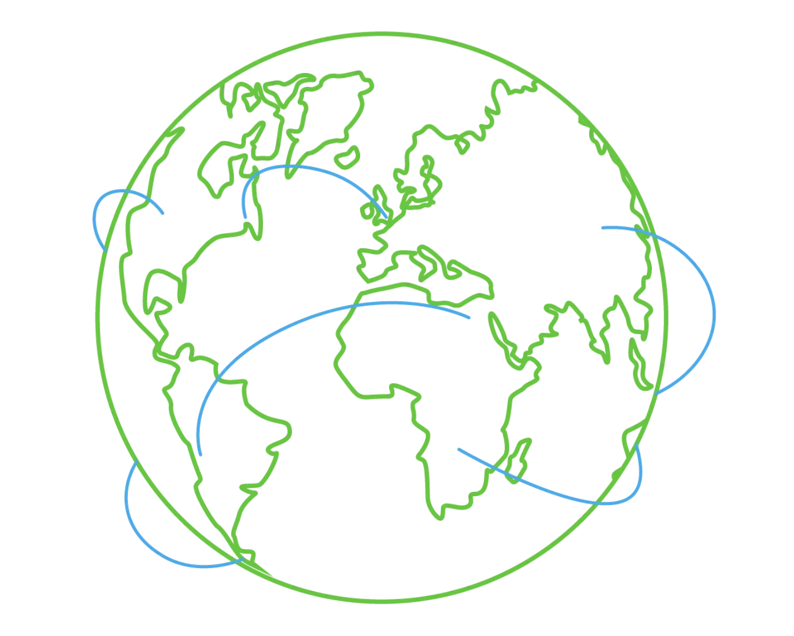

# Modelo OSI

El modelo **OSI** (*Open Systems Interconnection*, Interconexión de Sistemas Abiertos) es un modelo conceptual desarrollado por la Organización Internacional de Normalización (**ISO**) que describe cómo deben producirse las comunicaciones en una red informática. Dicho de otro modo, el modelo OSI define un marco de trabajo para las comunicaciones en redes de computadoras.

Aunque este modelo es teórico, es fundamental aprenderlo y comprenderlo, ya que ayuda a entender los conceptos de redes en mayor profundidad. El modelo OSI se compone de **siete capas**:

| Capa | Descripción |
| ---- | ----------- |
| **Capa física** | Se ocupa de la transmisión por hardware (cables, switches). |
| **Capa de enlace de datos** | Garantiza una transferencia de datos sin errores entre dos nodos de la misma red. |
| **Capa de red** | Se encarga de enrutar los paquetes entre distintas redes (direcciones IP). |
| **Capa de transporte** | Ofrece transferencia de datos fiable o no fiable (TCP/UDP). |
| **Capa de sesión** | Gestiona las sesiones entre aplicaciones. |
| **Capa de presentación** | Da formato a los datos para la capa de aplicación (cifrado, compresión). |
| **Capa de aplicación** | Interactúa directamente con las aplicaciones del usuario (HTTP, FTP). |

### Responde a las siguientes preguntas

### Pregunta 1

**¿Qué capa es responsable de conectar una aplicación con otra?**

**Respuesta:** `Layer 4` 

### Pregunta 2

**¿Qué capa es responsable de enrutar los paquetes a la red adecuada?**

**Respuesta:** `Layer 3`

### Pregunta 3

**En el modelo OSI, ¿qué capa es responsable de codificar los datos de la aplicación?**

**Respuesta:** `Layer 6` 

### Pregunta 4

**¿Qué capa es responsable de transferir datos entre hosts del mismo segmento de red?**

**Respuesta:** `Layer 2`

### Resumen

| N.º de capa | Nombre de la capa | Función principal | Ejemplos de protocolos y estándares |
| ----------- | ----------------- | ----------------- | ----------------------------------- |
| **Capa 7** | Capa de aplicación | Proporcionar servicios e interfaces a las aplicaciones. | HTTP, FTP, DNS, POP3, SMTP, IMAP |
| **Capa 6** | Capa de presentación | Codificación, cifrado y compresión de datos. | Unicode, MIME, JPEG, PNG, MPEG |
| **Capa 5** | Capa de sesión | Establecer, mantener y sincronizar sesiones. | NFS, RPC |
| **Capa 4** | Capa de transporte | Comunicación de extremo a extremo y segmentación de datos. | UDP, TCP |
| **Capa 3** | Capa de red | Direccionamiento lógico y enrutamiento entre redes. | IP, ICMP, IPSec |
| **Capa 2** | Capa de enlace de datos | Transferencia fiable de datos entre nodos adyacentes. | Ethernet (802.3), WiFi (802.11) |
| **Capa 1** | Capa física | Medios físicos de transmisión de datos. | Señales eléctricas, ópticas e inalámbricas |

## Modelo TCP/IP

TCP/IP significa *Transmission Control Protocol/Internet Protocol* (Protocolo de Control de Transmisión/Protocolo de Internet) y fue desarrollado en la década de 1970 por el Departamento de Defensa de EE. UU. (**DoD**).

## Las capas del modelo TCP/IP

Al presentar el modelo ISO OSI fuimos de abajo arriba, de la capa 1 a la capa 7. En esta tarea veremos las cosas desde otra perspectiva: **de arriba abajo**. 

| Capa | Descripción |
| ---- | ----------- |
| **Capa de aplicación** | Las capas de aplicación, presentación y sesión del modelo OSI (capas 5, 6 y 7) se agrupan en la capa de aplicación del modelo TCP/IP. |
| **Capa de transporte** | Es la capa 4. |
| **Capa de Internet** | Es la capa 3. La capa de red del modelo OSI se llama capa de Internet en el modelo TCP/IP. |
| **Capa de enlace** | Es la capa 2. |

## Correspondencia entre OSI y TCP/IP

La siguiente tabla muestra cómo se corresponden las capas del modelo TCP/IP con las del modelo ISO/OSI.

| N.º de capa | Modelo ISO OSI | Modelo TCP/IP (RFC 1122) | Protocolos |
| ----------- | -------------- | ------------------------ | ---------- |
| **7** | Capa de aplicación | Capa de aplicación | HTTP, HTTPS, FTP, POP3, SMTP, IMAP, Telnet, SSH |
| **6** | Capa de presentación | *(incluida en la capa de aplicación)* | |
| **5** | Capa de sesión | *(incluida en la capa de aplicación)* | |
| **4** | Capa de transporte | Capa de transporte | TCP, UDP |
| **3** | Capa de red | Capa de Internet | IP, ICMP, IPSec |
| **2** | Capa de enlace de datos | Capa de enlace | Ethernet 802.3, WiFi 802.11 |
| **1** | Capa física | *(incluida en la capa de enlace)* | |

## TCP/IP en cinco capas

Muchos libros modernos de redes presentan el modelo TCP/IP con **cinco capas** en lugar de cuatro. Por ejemplo, en *Computer Networking: A Top-Down Approach* (8.ª edición), Kurose y Ross describen la siguiente pila de protocolos de Internet de cinco capas, que incluye la capa física:

1. **Aplicación** (*Application*)
2. **Transporte** (*Transport*)
3. **Red** (*Network*)
4. **Enlace** (*Link*)
5. **Física** (*Physical*)

## Direcciones IP y subredes

Cada host de la red necesita un identificador único para que otros hosts puedan comunicarse con él. Sin un identificador único, no se puede encontrar al host sin ambigüedad. Al usar el conjunto de protocolos TCP/IP, necesitamos asignar una dirección IP a cada dispositivo conectado a la red.

## ¿Cómo está formada una dirección IP?

Una dirección IP se compone de **cuatro octetos**, es decir, **32 bits**. Al ser de 8 bits, un octeto permite representar un número decimal entre 0 y 255.

*Una dirección IP está formada por 4 octetos o bytes, y cada octeto representa un número decimal entre 0 y 255.*

A riesgo de simplificar demasiado, el `0` y el `255` están reservados para las direcciones de **red** y de **difusión** (*broadcast*), respectivamente. Es decir, `192.168.1.0` es la dirección de red, mientras que `192.168.1.255` es la dirección de difusión. Enviar datos a la dirección de difusión los dirige a todos los hosts de la red.

Con un cálculo sencillo, puedes concluir que no puede haber más de 4000 millones de direcciones IPv4 únicas, son aproximadamente 2<sup>32</sup>, porque tenemos 32 bits. Es una cifra aproximada porque no hemos tenido en cuenta las direcciones de red y de difusión.
## Consultar tu configuración de red

Puedes consultar tu dirección IP en la línea de comandos de MS Windows con el comando `ipconfig`. En Linux y en sistemas basados en UNIX, puedes usar `ifconfig` o `ip address show`, que se puede escribir como `ip a s`. 

**Terminal**

```
user@TryHackMe$ ifconfig
[...]
wlo1: flags=4163<UP,BROADCAST,RUNNING,MULTICAST>  mtu 1500
        inet 192.168.66.89  netmask 255.255.255.0  broadcast 192.168.66.255
        inet6 fe80::73e1:ca5e:3f93:b1b3  prefixlen 64  scopeid 0x20<link>
        ether cc:5e:f8:02:21:a7  txqueuelen 1000  (Ethernet)
        RX packets 19684680  bytes 18865072842 (17.5 GiB)
        RX errors 0  dropped 364  overruns 0  frame 0
        TX packets 14439678  bytes 8773200951 (8.1 GiB)
        TX errors 0  dropped 0 overruns 0  carrier 0  collisions 0
```

La salida anterior indica lo siguiente:

- La dirección IP del host (portátil) es `192.168.66.89`.
- La máscara de subred es `255.255.255.0`.
- La dirección de difusión es `192.168.66.255`.

Usemos ahora `ip a s` para comparar cómo se presenta la dirección IP de la tarjeta de red.

**Terminal**

```
user@TryHackMe$ ip a s
[...]
4: wlo1: <BROADCAST,MULTICAST,UP,LOWER_UP> mtu 1500 qdisc noqueue state UP group default qlen 1000
    link/ether cc:5e:f8:02:21:a7 brd ff:ff:ff:ff:ff:ff
    altname wlp3s0
    inet 192.168.66.89/24 brd 192.168.66.255 scope global dynamic noprefixroute wlo1
       valid_lft 36795sec preferred_lft 36795sec
    inet6 fe80::73e1:ca5e:3f93:b1b3/64 scope link noprefixroute 
       valid_lft forever preferred_lft forever
```

La salida anterior indica lo siguiente:

- La dirección IP del host (portátil) es `192.168.66.89/24`.
- La dirección de difusión es `192.168.66.255`.

## Máscara de subred y notación `/24`

Si te lo estás preguntando, una máscara de subred `255.255.255.0` también se puede escribir como `/24`. El `/24` significa que los 24 bits más a la izquierda de la dirección IP no cambian en toda la red, es decir, en la subred. Dicho de otro modo, los tres octetos de la izquierda son iguales en toda la subred; por lo tanto, podemos esperar direcciones que van desde `192.168.66.1` hasta `192.168.66.254`. Como se mencionó antes, `192.168.66.0` y `192.168.66.255` son las direcciones de red y de difusión, respectivamente.

## Direcciones privadas

Ya que estamos explicando las direcciones IP, conviene mencionar que, para la mayoría de los fines prácticos, hay dos tipos de direcciones IP:

- Direcciones IP **públicas**.
- Direcciones IP **privadas**.

La **RFC 1918** define los siguientes tres rangos de direcciones IP privadas:

| Rango | Notación CIDR |
| ----- | ------------- |
| `10.0.0.0` – `10.255.255.255` | `10/8` |
| `172.16.0.0` – `172.31.255.255` | `172.16/12` |
| `192.168.0.0` – `192.168.255.255` | `192.168/16` |

Antes presentamos una analogía que decía que una dirección IP pública es como tu dirección postal. Una dirección IP privada es diferente: la idea original es que no puede llegar al mundo exterior ni ser alcanzada desde él. Es como una ciudad aislada o un complejo residencial, donde todas las casas y apartamentos están numerados de forma sistemática y pueden intercambiar correo fácilmente entre sí, pero no con el mundo exterior.

Para que una dirección IP privada pueda acceder a internet, el router debe tener una dirección IP pública y admitir la **traducción de direcciones de red** (*Network Address Translation*, **NAT**). 

## Enrutamiento

Un router reenvía los paquetes de datos a la red adecuada. Normalmente, un paquete de datos pasa por varios routers antes de llegar a su destino final. El router funciona en la **capa 3**: inspecciona la dirección IP y reenvía el paquete a la mejor red (router), de modo que el paquete se acerque a su destino.

## Ejercicio: 

**¿Cuál de las siguientes direcciones IP no es una dirección IP privada?**

- `192.168.250.125`
- `10.20.141.132` 
- `49.69.147.197` 
- `172.23.182.251` 

**Respuesta:** `49.69.147.197` 

### Explicación 

Según la RFC 1918, los rangos de direcciones privadas son: 

| Dirección | ¿Privada? | Motivo | | --------- | --------- | ------ | 
| `192.168.250.125` | Sí | Está en `192.168.0.0/16`. | 
| `10.20.141.132` | Sí | Está en `10.0.0.0/8`. | 
| `49.69.147.197` | **No** | No está en ningún rango privado, es **pública**. | 
| `172.23.182.251` | Sí | Está en `172.16.0.0/12` (de `172.16.0.0` a `172.31.255.255`). |

**¿Cuál de las siguientes direcciones IP no es una dirección IP válida?**

- `192.168.250.15`
- `192.168.254.17`
- `192.168.305.19`
- `192.168.199.13`

**Respuesta:** `192.168.305.19`

### Explicación

Una dirección IPv4 se compone de cuatro octetos, y cada uno debe estar entre `0` y `255`.

## UDP y TCP

El protocolo IP nos permite llegar a un host de destino en la red, identificado por su dirección IP. Pero necesitamos protocolos que permitan que los **procesos** de los hosts conectados en red se comuniquen entre sí. Existen dos protocolos de transporte para lograrlo: **UDP** y **TCP**.

## UDP

**UDP** (*User Datagram Protocol*, Protocolo de Datagramas de Usuario) nos permite llegar a un proceso concreto del host de destino. UDP es un protocolo sencillo y **sin conexión** que opera en la capa de transporte, es decir, la capa 4. Al no tener conexión, no necesita establecer una. UDP ni siquiera ofrece un mecanismo para saber si el paquete ha sido entregado.

Una dirección IP identifica al host, pero necesitamos un mecanismo para determinar el proceso emisor y el receptor. Esto se consigue con los **números de puerto**. Un número de puerto usa dos octetos; por lo tanto, va de **1 a 65535**, y el puerto 0 está reservado. (El número 65535 se calcula con la expresión 2<sup>16</sup> − 1).

Un ejemplo de la vida real parecido a UDP es el servicio de correo estándar, sin confirmación de entrega. En otras palabras, no hay garantía de que el paquete UDP se haya recibido correctamente, igual que ocurre al enviar un paquete por correo estándar sin confirmación de entrega. En el caso del correo estándar, eso significa un coste menor que las opciones con confirmación. En el caso de UDP, significa **mayor velocidad** que un protocolo de transporte que ofrezca «confirmación».

Pero ¿y si queremos un protocolo de transporte que confirme los paquetes recibidos? La respuesta está en usar TCP en lugar de UDP.

## TCP

**TCP** (*Transmission Control Protocol*, Protocolo de Control de Transmisión) es un protocolo de transporte **orientado a conexión**. Utiliza varios mecanismos para garantizar la entrega fiable de los datos enviados por los distintos procesos de los hosts en red. Al igual que UDP, es un protocolo de capa 4. Al estar orientado a conexión, requiere establecer una conexión TCP antes de poder enviar cualquier dato.

En TCP, cada octeto de datos tiene un **número de secuencia**, lo que facilita que el receptor identifique paquetes perdidos o duplicados. Por su parte, el receptor confirma la recepción de los datos con un **número de confirmación** (*acknowledgement number*)  que indica el último octeto recibido.

## El saludo en tres pasos (*three-way handshake*)

Una conexión TCP se establece mediante lo que se llama un *three-way handshake*. Se usan dos indicadores (*flags*): **SYN** (*Synchronise*, sincronizar) y **ACK** (*Acknowledgment*, confirmación). Los paquetes se envían así:

| Paso | Paquete | Descripción |
| ---- | ------- | ----------- |
| **1** | **SYN** | El cliente inicia la conexión enviando un paquete SYN al servidor. Este paquete contiene el número de secuencia inicial, elegido al azar por el cliente. |
| **2** | **SYN-ACK** | El servidor responde al paquete SYN con un paquete SYN-ACK, que añade el número de secuencia inicial elegido al azar por el servidor. |
| **3** | **ACK** | El saludo en tres pasos se completa cuando el cliente envía un paquete ACK para confirmar la recepción del paquete SYN-ACK. |

Al igual que UDP, TCP identifica el proceso que inicia o espera (*escucha*) una conexión mediante números de puerto. Como se indicó, un número de puerto válido va de **1 a 65535**, porque usa dos octetos, y el puerto 0 está reservado.

## Comparativa: UDP vs. TCP

| Característica | UDP | TCP |
| -------------- | --- | --- |
| **Conexión** | Sin conexión. | Orientado a conexión (requiere *three-way handshake*). |
| **Fiabilidad** | No garantiza la entrega ni avisa de ella. | Garantiza la entrega mediante números de secuencia y confirmaciones. |
| **Velocidad** | Más rápido. | Más lento por sus mecanismos de control. |
| **Capa** | Capa 4 (transporte). | Capa 4 (transporte). |
| **Identificación de procesos** | Puertos del 1 al 65535. | Puertos del 1 al 65535. |
| **Analogía** | Correo estándar, sin confirmación de entrega. | Correo con confirmación de entrega. |

## Encapsulación

En este contexto, la encapsulación se refiere al proceso por el cual cada capa añade una cabecera (*header*) y, a veces, un tráiler (*trailer*) a la unidad de datos recibida, y envía la unidad «encapsulada» a la capa inferior. La encapsulación es un concepto esencial porque permite que cada capa se centre en su función prevista.

| Paso | Unidad de datos | Descripción |
| ---- | --------------- | ----------- |
| **1** | **Datos de aplicación** | Todo comienza cuando el usuario introduce en la aplicación los datos que quiere enviar. Por ejemplo, escribes un correo electrónico o un mensaje instantáneo y pulsas el botón de enviar. La aplicación da formato a estos datos y comienza a enviarlos según el protocolo de aplicación utilizado, mediante la capa inferior: la capa de transporte. |
| **2** | **Segmento o datagrama del protocolo de transporte** | La capa de transporte, como TCP o UDP, añade la información de cabecera adecuada y crea el segmento TCP (o el datagrama UDP). Este segmento se envía a la capa inferior: la capa de red. |
| **3** | **Paquete de red** | La capa de red, es decir, la capa de Internet, añade una cabecera IP al segmento TCP o datagrama UDP recibido. Después, este paquete IP se envía a la capa inferior: la capa de enlace de datos. |
| **4** | **Trama de enlace de datos** | Ethernet o WiFi recibe el paquete IP y le añade la cabecera y el tráiler adecuados, creando una **trama** (*frame*). |

Empezamos con los datos de aplicación. En la capa de transporte añadimos una cabecera TCP o UDP para crear un segmento TCP o un datagrama UDP. De nuevo, en la capa de red añadimos la cabecera IP adecuada para obtener un paquete IP que se pueda enrutar por Internet. Por último, añadimos la cabecera y el tráiler apropiados para obtener una trama WiFi o Ethernet en la capa de enlace.

El proceso se invierte en el extremo receptor hasta que se extraen los datos de aplicación.

## El ciclo de un paquete

Consideremos el escenario en el que buscas una sala en TryHackMe.

1. En la página de búsqueda de TryHackMe, introduces tu consulta y pulsas Enter.
2. Tu navegador web, usando HTTPS, prepara una petición HTTP y la envía a la capa inferior: la capa de transporte.
3. La capa TCP necesita establecer una conexión mediante un *three-way handshake* entre tu navegador y el servidor web de TryHackMe. Una vez establecida la conexión TCP, puede enviar la petición HTTP que contiene la consulta de búsqueda. Cada segmento TCP creado se envía a la capa inferior: la capa de Internet.
4. La capa IP añade la dirección IP de origen (la de tu ordenador) y la dirección IP de destino (la del servidor web de TryHackMe). Para que este paquete llegue al router, tu portátil lo entrega a la capa inferior: la capa de enlace.
5. Según el protocolo, la capa de enlace añade la cabecera y el tráiler de enlace adecuados, y el paquete se envía al router.
6. El router elimina la cabecera y el tráiler de enlace, inspecciona la dirección IP de destino, entre otros campos, y enruta el paquete al enlace adecuado. Cada router repite este proceso hasta llegar al router del servidor de destino.

Los pasos se invertirán cuando el paquete llegue al router de la red de destino. A medida que veamos más protocolos, volveremos a este ejercicio y crearemos una versión más detallada.

## Resumen de la encapsulación

| Capa | Unidad de datos | Qué se añade |
| ---- | --------------- | ------------ |
| Aplicación | Datos | Formato según el protocolo de aplicación. |
| Transporte | Segmento (TCP) o datagrama (UDP) | Cabecera TCP o UDP (incluye los puertos). |
| Red (Internet) | Paquete | Cabecera IP (direcciones IP de origen y destino). |
| Enlace de datos | Trama (*frame*) | Cabecera y tráiler de Ethernet o WiFi. |

## Telnet

El protocolo **TELNET** (*Teletype Network*) es un protocolo de red para la conexión remota a una terminal. En palabras más simples, `telnet`, un cliente TELNET, te permite conectarte y comunicarte con un sistema remoto y ejecutar comandos de texto. Aunque en un principio se usaba para la administración remota, podemos usar `telnet` para conectarnos a cualquier servidor que esté escuchando en un puerto TCP.

En la máquina objetivo del laboratorio se ejecutan distintos servicios:

| Servidor | Puerto por defecto | Descripción |
| -------- | ------------------ | ----------- |
| **Servidor Echo** | `7` | Devuelve (hace eco de) todo lo que le envías. |
| **Servidor Daytime** | `13` | Responde con la fecha y la hora actuales. |
| **Servidor web (HTTP)** | `80` (TCP) | Sirve páginas web. |

## Servidor Echo (puerto 7)

En la terminal siguiente nos conectamos a la VM objetivo en el puerto TCP 7 del servidor Echo. Para cerrar la conexión, pulsa simultáneamente las teclas `CTRL` + `]`.

**Terminal**

```
user@TryHackMe$ telnet MACHINE_IP 7
telnet MACHINE_IP 7
Trying MACHINE_IP...
Connected to MACHINE_IP.
Escape character is '^]'.
Hi
Hi
How are you?
How are you?
Bye
Bye
^]

telnet> quit
Connection closed.
```

## Servidor Daytime (puerto 13)

En la terminal siguiente usamos `telnet` para conectarnos al servidor Daytime, que escucha en el puerto 13. Observamos que la conexión se cierra en cuanto se devuelven la fecha y la hora actuales.

**Terminal**

```
user@TryHackMe$ telnet MACHINE_IP 13
Trying MACHINE_IP...
Connected to MACHINE_IP.
Escape character is '^]'.
Thu Jun 20 12:36:32 PM UTC 2024
Connection closed by foreign host.
```

## Servidor web HTTP (puerto 80)

Por último, solicitemos una página web usando `telnet`. Después de conectarte al puerto 80, debes escribir el comando `GET / HTTP/1.1` e indicar el host, donde sirve cualquier valor, como `Host: telnet.thm`. A continuación, debes pulsar `Enter` dos veces para que la última línea introducida sea una línea en blanco. La salida siguiente muestra el intercambio. (La página se ha omitido).

**Terminal**

```
user@TryHackMe$ telnet MACHINE_IP 80
Trying MACHINE_IP...
Connected to MACHINE_IP.
Escape character is '^]'.
GET / HTTP/1.1
Host: telnet.thm

HTTP/1.1 200 OK
Content-Type: text/html
[...]

Connection closed by foreign host.
```

|Concepto | Qué es | Ejemplo | 
| -------- | ------ | ------- | 
| **Dirección IP** | Identificador lógico de un equipo en una red. Puede cambiar. | `192.168.66.133` | 
| **Dirección MAC** | Identificador físico, grabado en la tarjeta de red. Normalmente no cambia. | `44:DF:65:D8:FE:6C` | 
| **Capa 2 (enlace)** | Entrega de datos dentro de la misma red local, usando direcciones MAC. | Ethernet, WiFi | 
| **Capa 3 (red)** | Entrega de datos entre redes distintas, usando direcciones IP. | IPv4, IPv6 | | **Puerto UDP** | Número que identifica a qué servicio o programa va dirigido un paquete. | `67`, `68` | 
| **Broadcast (difusión)** | Mensaje enviado a *todos* los equipos de la red local. | `255.255.255.255` (IP) y `ff:ff:ff:ff:ff:ff` (MAC) | 

## DHCP: cómo un equipo obtiene su configuración de red

DHCP es un protocolo de **nivel de aplicación** que se apoya en **UDP**: el servidor escucha en el **puerto UDP 67** y el cliente envía desde el **puerto UDP 68**. El teléfono y el móvil están configurados para usar DHCP por defecto.

| Elemento | Puerto UDP |
| -------- | ---------- |
| Servidor DHCP | `67` |
| Cliente DHCP | `68` |

En el protocolo DHCP, **DORA** son las siglas de *Discover*, *Offer*, *Request* y *Acknowledge*. DHCP sigue cuatro pasos:

| Paso | Mensaje | Descripción |
| ---- | ------- | ----------- |
| **D**iscover | `DHCPDISCOVER` | El cliente envía un mensaje de difusión (*broadcast*) para buscar el servidor DHCP local, si existe. |
| **O**ffer | `DHCPOFFER` | El servidor responde con un mensaje con una dirección IP disponible que el cliente puede aceptar. |
| **R**equest | `DHCPREQUEST` | El cliente responde con un mensaje para indicar que ha aceptado la IP ofrecida. |
| **A**cknowledge | `DHCPACK` | El servidor responde con un mensaje para confirmar que la dirección IP ofrecida ya está asignada a este cliente. |

- **El `Transaction ID` es el mismo en los cuatro paquetes.** Sirve para saber que todos forman parte de la misma negociación. 
- **El cliente empieza sin IP**, por eso los paquetes 1 y 3 salen desde `0.0.0.0`. 
- **El servidor (`192.168.66.1`) ofrece la IP `192.168.66.133`** en el paquete 2 y la confirma en el 4.
- Como el cliente todavía no tiene IP, usa `0.0.0.0` como origen y envía a la IP de difusión `255.255.255.255`.
Al terminar el proceso, el equipo tiene, como mínimo: - **Dirección IP** para comunicarse dentro de la red. - **Máscara de subred**, que define qué direcciones son locales. - **Puerta de enlace** (*gateway*), normalmente el router, para salir a otras redes o a internet. - **Servidor DNS**, para traducir nombres como `ejemplo.com` a direcciones IP. - **Tiempo de concesión** (*lease time*), que indica cuánto tiempo puede usar esa IP antes de renovarla. 

**Terminal**

```
user@TryHackMe$ tshark -r DHCP-G5000.pcap -n
    1   0.000000      0.0.0.0 → 255.255.255.255 DHCP 342 DHCP Discover - Transaction ID 0xfb92d53f
    2   0.013904 192.168.66.1 → 192.168.66.133 DHCP 376 DHCP Offer    - Transaction ID 0xfb92d53f
    3   4.115318      0.0.0.0 → 255.255.255.255 DHCP 342 DHCP Request  - Transaction ID 0xfb92d53f
    4   4.228117 192.168.66.1 → 192.168.66.133 DHCP 376 DHCP ACK      - Transaction ID 0xfb92d53f
```

En el intercambio de paquetes DHCP podemos observar lo siguiente:

- El cliente empieza **sin ninguna configuración de red IP**. Solo tiene una dirección MAC. En los paquetes primero y tercero (*DHCP Discover* y *DHCP Request*), el cliente que busca un servidor DHCP sigue sin configuración IP y todavía no ha usado la dirección IP ofrecida por el servidor. Por eso envía los paquetes desde la dirección IP `0.0.0.0` a la dirección IP de difusión `255.255.255.255`.
- En cuanto a la capa de enlace, en los paquetes primero y tercero el cliente envía a la dirección MAC de difusión, `ff:ff:ff:ff:ff:ff` (no se muestra en la salida anterior). El servidor DHCP ofrece una dirección IP disponible junto con la configuración de red en el *DHCP Offer*, y usa como destino la dirección MAC del cliente. (En este sistema de ejemplo, usó la dirección IP propuesta).

¿Qué recibimos al final?

Al final del proceso DHCP, nuestro dispositivo habrá recibido toda la configuración necesaria para acceder a la red, o incluso a internet. En concreto, esperamos que el servidor DHCP nos haya proporcionado lo siguiente:

- La **dirección IP cedida** (*leased*) para acceder a los recursos de la red.
- La **puerta de enlace** para enrutar nuestros paquetes fuera de la red local.
- Un **servidor DNS** para resolver nombres de dominio (más sobre esto más adelante).

## ARP, el puente entre el direccionamiento de capa 3 y el de capa 2

Cuando un equipo quiere enviar datos a otro en la **misma red local**, debe construir una trama Ethernet o WiFi, y para eso necesita la **dirección MAC** del destino. Pero normalmente solo conoce su **IP**.

Hay que distinguir dos situaciones: - Dentro de la **misma red**, los datos se entregan usando la MAC del destino. - Hacia **otras redes**, los datos se envían a la MAC del **router**, aunque la IP de destino sea otra. Por eso ARP solo es necesario mientras dos equipos se comunican en la misma red local.

Cuando dos hosts se comunican por una red, un paquete IP se encapsula dentro de una **trama de enlace de datos** (*data link frame*) al viajar por la capa 2. Recuerda que las dos capas de enlace de datos más comunes son **Ethernet** (IEEE 802.3) y **WiFi** (IEEE 802.11). Siempre que un host necesita comunicarse con otro host en la misma red Ethernet o WiFi, debe enviar el paquete IP dentro de una trama de la capa de enlace de datos. Aunque conoce la dirección IP del host de destino, necesita averiguar su **dirección MAC** para poder crear la cabecera de enlace de datos adecuada.

La dirección MAC es un número de 48 bits que suele representarse en notación hexadecimal; por ejemplo, `7C:DF:A1:D3:8C:5C` y `44:DF:65:D8:FE:6C` son dos direcciones MAC de mi red.

## ¿Cuándo se necesitan las direcciones MAC?

Los dispositivos de una misma red Ethernet no necesitan conocer las direcciones MAC de los demás en todo momento; solo las necesitan **mientras se comunican**. Todo gira en torno a las direcciones IP.

Al conectar un dispositivo a una red y, si la red tiene un servidor DHCP, el dispositivo se configura automáticamente para usar una puerta de enlace (router) y un servidor DNS concreto. En consecuencia, el dispositivo conoce la dirección IP del servidor DNS para resolver cualquier nombre de dominio y la del router para cuando necesite enviar paquetes por internet. En todo este escenario no se revela ninguna dirección MAC. Sin embargo, dos dispositivos de la misma red Ethernet **no pueden comunicarse sin conocer las direcciones MAC del otro**.

En un paquete IP dentro de una trama Ethernet. La cabecera de la trama Ethernet contiene:

- Dirección MAC de destino.
- Dirección MAC de origen.
- Tipo (en este caso, IPv4).

## El protocolo ARP

El **Protocolo de Resolución de Direcciones** (*Address Resolution Protocol*, **ARP**) permite encontrar la dirección MAC de otro dispositivo de la red Ethernet.

En el ejemplo siguiente, un host con la dirección IP `192.168.66.89` quiere comunicarse con otro sistema con la dirección IP `192.168.66.1`. Envía una **ARP Request** (petición ARP) pidiendo que responda el host con la dirección IP `192.168.66.1`. La petición ARP se envía desde la dirección MAC del solicitante a la dirección MAC de difusión (*broadcast*), `ff:ff:ff:ff:ff:ff`, como se ve en el primer paquete. Poco después llegó la **ARP Reply** (respuesta ARP): el host con la dirección IP `192.168.66.1` respondió con su dirección MAC. A partir de ese momento, los dos hosts pueden intercambiar tramas de la capa de enlace de datos.

| Mensaje | Descripción |
| ------- | ----------- |
| **ARP Request** | «¿Quién tiene la IP `192.168.66.1`? Díselo a `192.168.66.89`». Se envía por difusión. |
| **ARP Reply** | «La IP `192.168.66.1` está en `44:df:65:d8:fe:6c`». Se envía directamente al solicitante. |

**Terminal**

```
user@TryHackMe$ tshark -r arp.pcapng -Nn
    1 0.000000000 cc:5e:f8:02:21:a7 → ff:ff:ff:ff:ff:ff ARP 42 Who has 192.168.66.1? Tell 192.168.66.89
    2 0.003566632 44:df:65:d8:fe:6c → cc:5e:f8:02:21:a7 ARP 42 192.168.66.1 is at 44:df:65:d8:fe:6c
```

Si usamos `tcpdump`, los paquetes se muestran de forma distinta. Utiliza los términos *ARP Request* y *ARP Reply*. A modo informativo, la salida se muestra en la terminal siguiente.

**Terminal**

```
user@TryHackMe$ tcpdump -r arp.pcapng -n -v
17:23:44.506615 ARP, Ethernet (len 6), IPv4 (len 4), Request who-has 192.168.66.1 tell 192.168.66.89, length 28
17:23:44.510182 ARP, Ethernet (len 6), IPv4 (len 4), Reply 192.168.66.1 is-at 44:df:65:d8:fe:6c, length 28
```

## Encapsulación de ARP

Una petición o respuesta ARP **no se encapsula dentro de un paquete UDP ni siquiera IP**; se encapsula **directamente dentro de una trama Ethernet**. La siguiente respuesta ARP lo muestra.

 ¿Capa 2 o capa 3?

ARP se considera de **capa 2** porque trabaja con direcciones MAC. Otros argumentan que forma parte de la **capa 3** porque da soporte a las operaciones IP. Lo importante es saber que ARP permite la **traducción del direccionamiento de capa 3 al direccionamiento de capa 2**.
